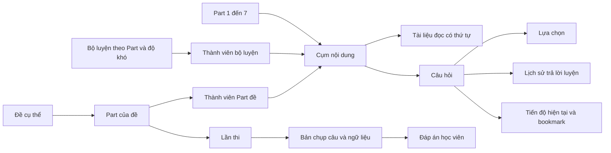

# Đánh giá kiến trúc TOEICUP — 22/10/2026

> Đây là bản đánh giá trước refactor. Các thay đổi đã triển khai, API hiện tại, kiểm thử và quy trình chuyển database được ghi trong [BACKEND_ARCHITECTURE.md](BACKEND_ARCHITECTURE.md).

## Kết luận

Thiết kế hiện tại đủ làm bản CRUD ban đầu, nhưng chưa là nền tảng tốt cho website học TOEIC theo Part. Vấn đề chính là mô hình nội dung: cùng một khái niệm câu hỏi được triển khai ba lần; thiếu cụm câu hỏi dùng chung ngữ liệu; nội dung, vị trí trong bộ luyện và lịch sử làm bài còn phụ thuộc nhau quá chặt.

Nên thống nhất ngân hàng nội dung và tách rõ bộ luyện, đề thi, lần làm bài và tiến độ. Vẫn giữ giao diện học riêng cho Listening/Reading và từng Part. Số bảng ít hơn không phải thước đo duy nhất của thiết kế sạch; quan trọng là mỗi bảng có một trách nhiệm và dữ liệu không phải sao chép để tái sử dụng.

## Phạm vi và mức độ xác minh

- Đã đọc 97 file `.js`, `.jsx`, `.css` trong `toeic_web/src`, cấu hình frontend và tài liệu frontend.
- Đã đối chiếu 23 entity backend, repository, mapper, DTO, controller, các service nghiệp vụ và cấu hình xác thực liên quan.
- Frontend: `npm.cmd run build` thành công; `npm.cmd run lint` exit 0, có 29 cảnh báo, chủ yếu về dependency của hooks và biểu thức trong trang admin.
- Đây là đánh giá mã nguồn và schema khai báo qua JPA. Chưa kết nối MySQL để kiểm tra DDL, index thực tế, dữ liệu trùng, execution plan hay hành vi API đang chạy. Các kết luận về thiếu constraint là thiếu trong mã nguồn được cung cấp; database thực tế có thể được chỉnh riêng.
- Không chạy backend context test: test hiện có tải toàn bộ ứng dụng; cấu hình đang dùng `ddl-auto: update`. Không cần khởi động ứng dụng/đụng database để hoàn thành lần review này.
- Chưa sửa logic ứng dụng, entity, API hay database. Chỉ bổ sung báo cáo này và chạy build/lint frontend.

## 1. Những vấn đề cần xử lý trước

### 1.1. P1 — Đáp án của bài thi được trả về trước khi nộp

`TestQuestionResponse.java:21` và `:26` chứa `correctAnswer`, `explanation`. `TestService.java:79` trả danh sách này qua mapper cho API học viên. Frontend chỉ truyền `revealed={false}` vào `OptionList`, nên đáp án vẫn có trong response/network.

Tách DTO admin, DTO đề đang làm và DTO review. API đề đang làm chỉ trả nội dung cần hiển thị; backend chấm bài. Với chế độ luyện có phản hồi ngay, có thể trả đáp án và giải thích sau khi ghi nhận câu trả lời.

### 1.2. P1 — Xóa nội dung có thể xóa lịch sử học và thi

`ListeningQuestion.java:70`, `ReadingQuestion.java:63` cascade ALL và orphanRemoval tới progress. `TestQuestion.java:67` cascade tới câu trả lời thi. `TestPart.java:52` cascade tới kết quả thi; `TestSuite.java:39` cascade xuống Part.

Ví dụ: xóa câu thi có thể xóa answer nhưng giữ lại tổng điểm cũ ở result; xóa Part thi có thể xóa cả lịch sử của học viên. Đây là cascade ở tầng JPA, không phải khẳng định database đang có `ON DELETE CASCADE`.

Nội dung đã dùng nên chuyển sang archived. Không cascade REMOVE từ nội dung sang lịch sử người học. Giữ bản chụp nội dung/đáp án của mỗi lần thi hoặc dùng phiên bản nội dung bất biến.

### 1.3. P1 — Trạng thái làm bài đang bị trộn với đánh dấu ôn tập

`ListeningUserProgress.java:35` và `ReadingUserProgress.java:35` dùng một enum cho `CORRECT`, `WRONG`, `UNANSWERED`, `MARKED`. `ListeningService.java:137` đổi thẳng status sang MARKED; Reading làm tương tự.

`toeic_web/src/utils/progress.js` chỉ tính CORRECT/WRONG, mọi giá trị còn lại thành chưa làm. Chuỗi thao tác “trả lời đúng → đánh dấu” vì vậy làm giảm số câu đúng và tăng số chưa làm. Dashboard lại lấy số dòng progress, nên câu chỉ đánh dấu hoặc đã reset vẫn được đếm là đã làm.

Đã thực thi trực tiếp hàm `summarizeLevelProgress` hiện tại với một câu: CORRECT cho `correct=1, unanswered=0`; đổi status thành MARKED cho `correct=0, unanswered=1`. Với cả MARKED và UNANSWERED, cách đếm `progress.length` của dashboard vẫn ra 1. Đây là kiểm chứng logic frontend; chưa gọi API/backend.

Tách `last_answer_correct`/trạng thái trả lời khỏi `is_bookmarked`. Bookmark không đổi `last_answered_at`. Lưu lịch sử trả lời riêng; reset trạng thái luyện hiện tại không xóa lịch sử đã học.

### 1.4. P1 — Thiếu uniqueness cho các quan hệ có ý nghĩa duy nhất

Entity hiện chưa khai báo các unique key sau:

| Quan hệ | Unique cần có |
| --- | --- |
| Tiến độ luyện nghe/đọc | `(user_id, question_id)` |
| Tiến độ từ vựng | `(user_id, word_id)` |
| Từ trong collection | `(collection_id, word_id)` |
| Câu trả lời thi | `(result_id, question_id)` |
| Level trong Part | `(part_id, level_number)` nếu mỗi Part có một bucket cho mỗi level |
| Part trong suite | `(suite_id, part_number)` nếu suite là một đề có bảy Part |
| Số câu trong level/Part thi | `(level_id, question_number)` hoặc `(part_id, question_number)` |

Progress dùng `findByUserIdAndQuestionId` rồi insert/update. Hai request đầu tiên đồng thời có thể tạo hai dòng; lần đọc sau qua Optional có thể lỗi vì có nhiều kết quả. Cần unique ở database và xử lý upsert/xung đột trong transaction. `@Transactional` đơn thuần không thay thế unique key.

`UserService` kiểm tra email tồn tại nhưng `User.java:31` chưa có unique email; cần thống nhất cách chuẩn hóa email và constraint tương ứng. Kiểm tra trùng trước insert không ngăn race condition.

## 2. Mô hình nội dung chưa sát luồng học

### 2.1. Ba ngân hàng câu hỏi độc lập

`ListeningQuestion`, `ReadingQuestion`, `TestQuestion` đều có câu hỏi, lựa chọn, đáp án và giải thích. Một câu muốn dùng cho luyện và thi phải tạo bản ghi ở hai nơi. Sửa nội dung không tự đồng bộ, ID không dùng chung, tiến độ và phân tích lỗi khó tổng hợp.

Listening/Reading có khác biệt về hiển thị và ngữ liệu, nhưng “luyện” và “thi” là cách sử dụng nội dung. Nên dùng ngân hàng câu hỏi chung, có Part và loại nội dung rõ ràng; bộ luyện và đề thi tham chiếu nội dung qua bảng thành viên có thứ tự.

### 2.2. Thiếu cụm câu hỏi dùng chung ngữ liệu

Listening chỉ có audio ở level hoặc từng câu, chưa có conversation/talk group. Một audio cho cả level không thay thế được quan hệ “audio này thuộc cụm câu nào”, và chưa có mốc bắt đầu/kết thúc để nghe riêng khi dùng file dài.

Reading có passage nhưng mỗi câu chỉ tham chiếu một passage. Có thể nhét nhiều văn bản vào một LONGTEXT, nhưng chưa biểu diễn được nhiều tài liệu độc lập có thứ tự, loại và hình ảnh trong cùng một cụm.

Đối chiếu [đề mẫu ETS](https://www.ets.org/content/dam/ets-org/pdfs/toeic/toeic-listening-reading-sample-test.pdf): Part 2 có ba lựa chọn; Part 3/4 có ba câu theo mỗi hội thoại/bài nói; Part 7 có câu hỏi theo một văn bản hoặc một nhóm văn bản. Đây là lý do cần mô hình group, không phải chỉ thêm nhiều field nullable vào Question.

`OptionList.jsx:15` luôn duyệt `OPTIONS = [A, B, C, D]` trong `constants/status.js:19`, nên Part 2 cũng hiện D. Lựa chọn cần lấy từ dữ liệu và kiểm tra theo Part. `imageUrl` cũng không nên được hiểu là chỉ dành cho Part 1: đề mẫu có hình/biểu đồ ở Part 3/4.

### 2.3. Passage của đề thi phụ thuộc vào level luyện đọc

`TestQuestion.java:35` dùng `ReadingPassage`, trong khi `ReadingPassage.java:24` bắt buộc có `ReadingLevel`. Muốn nhập đoạn đọc chỉ dùng trong đề thi vẫn phải gắn nó vào cấu trúc luyện đọc.

`ReadingQuestion` còn có cả `level_id` và passage có `level_id`. `AdminService.java:460` chỉ kiểm tra hai ID tồn tại, chưa kiểm tra chúng cùng level/Part. Có thể lưu câu ở level A nhưng passage ở level B; frontend tải passage theo A nên không tìm thấy đoạn đọc.

Nên để ngữ liệu thuộc group trong ngân hàng chung, không thuộc riêng một level. Bảng thành viên quyết định group xuất hiện trong bộ luyện hoặc đề nào.

### 2.4. Level đang kiêm nhiệm độ khó và chỗ chứa nội dung

Hiện tại `Part → Level → Questions`, frontend mặc định nói năm level. Chưa có khái niệm bộ/bài luyện độc lập bên trong một độ khó. Khi nội dung tăng, một level trở thành danh sách dài và audio chung càng khó quản lý.

Đề xuất `practice_sets(part_id, difficulty, title, position)`. Nếu muốn giữ giao diện hiện tại, ban đầu tạo một set cho mỗi Part/level. Sau này có thể có nhiều set cùng độ khó mà không đổi bản chất Question. Năm level là quy ước sản phẩm, cần định nghĩa rõ tiêu chí; chưa cần thuật toán thích nghi khi dữ liệu học còn ít.

## 3. Lần thi và lịch sử cần độc lập với nội dung đang sửa

- `TestExamPage.jsx` hiện chỉ render ảnh, câu hỏi, đáp án và audio của Part; không tải/render passage. Gắn passage ID ở admin chưa đủ để Part 6/7 làm bài đầy đủ.
- `TestService.java:111` tính thời gian đã trôi qua nhưng không kiểm tra `timeLimit`. Đồng hồ frontend có thể bị dừng/bỏ qua. Cần `expires_at` phía server và quy tắc rõ cho nộp khi hết hạn.
- `startTest` luôn tạo result mới; frontend tự start sau khi tải trang. Reload tạo lượt mới, mất answers đang giữ trong React state, đồng hồ khởi động lại. Cần start có chủ đích, resume attempt và lưu nháp đáp án theo attempt.
- Backend lấy danh sách câu hiện tại khi submit (`TestService.java:122`), nên admin thêm/xóa câu trong lúc thi sẽ đổi tập câu được chấm. Cần cố định nội dung và thứ tự tại lúc start.
- `TestMapper.java:45` lấy nội dung và đáp án đúng từ Question hiện tại khi xem lại. Sửa câu sau khi học viên nộp có thể làm review mâu thuẫn với `isCorrect`/score đã lưu. Cần snapshot hoặc revision bất biến.
- `submitTest` có transaction và chặn result đã submitted: đây là nền tảng tốt. Nhưng chưa có khóa/version chống hai request submit đồng thời. Cần unique answer và khóa attempt hoặc cập nhật trạng thái có điều kiện/idempotency.
- `questionCount` nhập tay nhưng submit dùng số câu thực tế. Nên tính số câu từ thành viên đề hoặc chỉ coi đó là số câu dự kiến, kiểm tra đủ trước publish.
- `score` hiện là phần trăm 0–100 (`TestService.java:161`). Với bài luyện từng Part, nên đặt tên `accuracy_percent` và hiển thị `%` để rõ ý nghĩa.
- `TestSuite` đang được đặt ví dụ cả “ETS 2026” và “TEST 1”. Chốt suite là một đề cụ thể. Chỉ thêm tầng collection/nguồn ở trên khi sản phẩm cần nhóm nhiều đề; không mở rộng sang thi full đề trong lần refactor này.

## 4. Đánh giá frontend

Nền tảng nên giữ: API tập trung ở service/httpClient; có layout, route guard và component dùng lại; admin có layout riêng; learner có màn hình theo nghiệp vụ. Chưa cần đổi framework hoặc viết lại toàn bộ UI.

Những phần cần làm gọn:

| Vị trí | Vấn đề và hướng xử lý |
| --- | --- |
| ListeningPage / ReadingPage | Tải toàn bộ câu của từng level và toàn bộ progress để tính vài số đếm. Trả summary theo Part/set từ backend. Với năm level, riêng bước thống kê đã cần sáu request. |
| DashboardPage | Đếm số dòng progress thay vì câu đã trả lời; `.catch(() => [])` biến lỗi server thành số 0. Trả thống kê có định nghĩa rõ, phân biệt lỗi tải và dữ liệu trống. |
| ListeningPracticePage / ReadingPracticePage | Lặp logic answer/reset/bookmark/pager. Tách hook điều khiển luyện chung; giữ renderer riêng theo loại Part và group. |
| Trang luyện | `partNumber` lấy từ URL quyết định layout trong khi questions lấy độc lập theo levelId. Cần xác nhận level thuộc Part hoặc dùng metadata backend làm nguồn quyết định. |
| Các trang management | Trộn phần lọc cha/con, request, form, CRUD trong cùng component. Tách selector phân cấp, form theo loại nội dung và hook dữ liệu; không tạo một form tổng quát quá nhiều nhánh. |
| Selector admin | Listening/Reading/Test chỉ set ID con khi có phần tử đầu tiên, chưa clear ID khi cha mới không có con. Có thể còn hiện/sửa dữ liệu của cha cũ. Clear dữ liệu/ID con và bỏ response cũ khi đổi cha. |
| useAdminListening/Reading/Tests/Vocabulary | Chỉ return service, không có logic React. Gọi service trực tiếp hoặc đưa việc tải/cache/mutation thực sự vào hook. |
| TestResultsPage | Dùng `partId` để hiện nhãn “Part”, nên ID database có thể bị hiểu thành số Part. Response nên có partNumber và tên đề. |
| Repository danh sách | Thiếu ORDER BY cho câu, level, Part và lịch sử learner; trang luyện không sort. Dùng position rõ ràng và sort ổn định; lịch sử gần đây cần startedAt DESC. |
| VocabularyWordsPage | Tên set lấy từ navigation state; truy cập URL trực tiếp thiếu metadata. Cần endpoint chi tiết set. |
| Từ vựng | Có model collection/progress nhưng chưa có luồng API/UI học tương ứng; lật thẻ chỉ là state hiển thị. Không nên coi đây là hệ thống theo dõi học từ đã hoàn thiện. |
| Bản dịch | Frontend gọi dịch/từ điển ngoài trực tiếp; bản dịch không được biên tập/lưu cùng nội dung. Fallback Chrome hiện không chạy nếu request MyMemory throw; nên sửa error handling. Bản dịch hỗ trợ học quan trọng nên có nội dung đã duyệt trong backend. |
| UI learner | Nhiều chỗ hiện tên entity, endpoint, “backend chưa hỗ trợ”. Thay bằng thông báo dành cho người học khi hoàn thiện luồng. |
| Code cũ | `pages/admin/UsersPage.jsx` không được router dùng; còn một admin users mới. Dọn sau khi xác nhận không có consumer khác. |

Auth cũng có hai nguồn token: httpClient refresh ghi localStorage nhưng AuthProvider không nhận token mới. `refreshProfile` có thể persist token cũ từ state trở lại. Nên có một nơi quản lý phiên/token và cập nhật context khi refresh. Đây là vấn đề frontend/session, không giải quyết bằng gộp bảng Question.

## 5. Đề xuất mô hình đích

Đây là bản thiết kế để triển khai tiếp, không phải migration đã chạy.

### Trách nhiệm bảng

| Bảng | Nội dung chính |
| --- | --- |
| `toeic_parts` | Bảy Part cố định: number, tên, hướng dẫn, section. Hạn chế sửa số Part sau khi có nội dung. |
| `question_groups` | part_id, loại cụm, audio_url, audio_start_ms/end_ms nếu dùng file dài, transcript, hình/biểu đồ chung, trạng thái draft/published/archived. Part 1/2/5 có thể là group một câu. |
| `group_documents` | group_id, position, loại tài liệu, title, content, image_url tùy nhu cầu. Một group có nhiều tài liệu để hiển thị Part 7 rõ ràng. |
| `questions` | group_id, position trong group, stem, explanation, nội dung dịch đã duyệt nếu cần. ID không phụ thuộc bộ luyện hay đề. |
| `question_options` | question_id, label, content, is_correct. Part 2 có A/B/C; phần khác theo cấu hình Part. Không lưu thêm correctAnswer độc lập nếu đã dùng is_correct. |
| `practice_sets` | part_id, difficulty, title, position, trạng thái xuất bản. Mỗi bộ chỉ chứa nội dung cùng Part. |
| `practice_set_groups` | set_id, group_id, position. Tái sử dụng cả cụm, giữ thứ tự và ngữ cảnh chung. |
| `test_suites`, `test_parts` | Giữ hai khái niệm hiện có; test_part tham chiếu toeic_part, time_limit_seconds và audio chung nếu có. |
| `test_part_groups` | test_part_id, group_id, position, số câu bắt đầu nếu cần giữ số gốc. Không nhân bản Question. |
| `test_attempts` | user_id, test_part_id, started_at, expires_at, submitted_at, status, correct_count, total_count, accuracy_percent; version hoặc cơ chế khóa. |
| `test_attempt_items` | attempt_id, position, source_question_id và snapshot nội dung, lựa chọn, đáp án, group/tài liệu/media. Tạo tại start, không đọc lại nội dung sống để chấm/review. |
| `test_attempt_answers` | attempt_item_id duy nhất, selected_label, is_correct sau chấm, answered_at. Có thể lưu nháp trước submit. |
| `practice_answer_events` | user_id, question_id, selected_label, is_correct_at_answer, answered_at, thời gian làm nếu thu thập được. Append thay vì ghi đè toàn bộ lịch sử. |
| `user_question_progress` | unique user/question, latest_answer, latest_correct, attempt_count, last_answered_at, is_bookmarked. Là trạng thái tổng hợp để đọc nhanh. |

Snapshot có thể lưu một payload JSON bất biến ở attempt/attempt item để giảm số bảng phụ; trường cần filter, join, index vẫn là cột quan hệ. Không biến toàn bộ ngân hàng câu hỏi thành JSON tự do. JSON đáp án đúng là dữ liệu nội bộ, không trả trong DTO đề đang làm.

Không cần thêm `question.part_id` nếu Part đã xác định qua group. Không lưu đồng thời partNumber/partType ở nhiều nơi có thể lệch nhau. Với membership giữa set/test_part và group, backend phải kiểm tra cùng Part trong transaction; FK đơn lẻ chỉ đảm bảo ID tồn tại. Khi cần bảo đảm ngay tại DB, thiết kế composite FK có part_id và unique key phù hợp.

Trước publish, kiểm tra số lựa chọn và đúng một lựa chọn đúng, cấu trúc group phù hợp Part, đủ media/ngữ liệu, không trùng position, và không có group thuộc Part khác. Unique key không tự bảo đảm quy tắc “đúng một đáp án” trên nhiều hàng; cần kiểm tra trong transaction và kiểm soát sửa nội dung đã publish.

### Từ vựng

Giữ Category → Set để tổ chức giao diện. Nếu cùng một từ cần nằm trong nhiều set, tách `vocabulary_set_items(set_id, word_id, position)` khỏi VocabularyWord. Không unique chỉ theo từ tiếng Anh vì một từ có thể có nhiều từ loại/nghĩa; xác định entry/meaning cụ thể trước khi gộp dữ liệu.

`pronunciation` hiện có comment là URL trong entity nhưng UI nhập/hiển thị phiên âm. Tách `phonetic` và `audio_url` nếu cần cả hai. Thêm `next_review_at` và lịch sử ôn chỉ khi thực sự triển khai ôn cách quãng. Collection mặc định và progress cần ràng buộc duy nhất phù hợp; không dùng unique `(user_id, is_default)` vì sẽ vô tình giới hạn cả collection không mặc định.

### Constraint và index

- Unique cho `(group_id, position)` của câu/tài liệu, `(question_id, label)` của lựa chọn; membership unique theo owner/group và owner/position.
- Unique `(user_id, question_id)` cho progress; index `(user_id, last_answered_at)` và các filter bookmark thường dùng.
- Unique `(attempt_id, position)` cho attempt item; unique attempt_item_id cho answer; index attempt `(user_id, started_at)` và `(status, expires_at)` nếu có xử lý hết hạn.
- Kiểm tra time limit > 0 cho bài có giới hạn; audio segment start >= 0, end > start; Part và độ khó thuộc miền được sản phẩm cho phép.
- Lịch sử dùng timestamp thống nhất, có quy ước UTC khi lưu/truyền. Archive nội dung, hạn chế hard delete khi đã tham chiếu.
- Dùng Flyway hoặc Liquibase và migration có version. Sau khi có baseline an toàn, đổi môi trường triển khai sang validate. Không dùng `ddl-auto: update` để di chuyển/gộp dữ liệu.
- MySQL có thể đã tạo index cho foreign key; kiểm tra DDL và truy vấn thực tế trước khi thêm index trùng hoặc tối ưu theo suy đoán.

## 6. API và tổ chức code sau refactor

- Learner lấy nội dung theo group, gồm danh sách documents và questions/options đã sắp thứ tự; không tự ghép passage từ một endpoint khác theo level.
- Summary endpoint trả số câu đã trả lời, đúng/sai theo lần gần nhất, bookmark, tổng số câu theo set/Part. Định nghĩa rõ “đã làm” và “đã hoàn thành”.
- Dùng `/me` cho hồ sơ/tiến độ của phiên hiện tại. `UserService.requireUser` hiện ưu tiên người dùng từ JWT, nên không nên kết luận chỉ thay userId query là sửa được progress người khác; tham số này chủ yếu đang thừa và gây hiểu nhầm.
- Attempt có API start/resume, lưu nháp, submit và review; server quyết định thời hạn và quyền sở hữu. Thi vẫn theo từng Part như sản phẩm hiện tại.
- Frontend có controller/hook luyện chung, renderer theo Part, component hiển thị group audio/documents. Tách logic gọi API khỏi form biên soạn nội dung.
- Backend chia theo nghiệp vụ như `content`, `practice`, `tests`, `vocabulary`, `users`, `auth`. Admin controller có thể riêng nhưng gọi service của module tương ứng; tách `AdminService` hiện đang gom gần 500 dòng và hơn 20 dependency.
- Giữ DTO riêng theo use case; dùng mapper cho ánh xạ dữ liệu, tránh mapper phải nạp và ghép lịch sử từ nội dung đang thay đổi.

## 7. Lỗi xác thực/phân quyền phát hiện kèm

Các lỗi dưới đây độc lập với việc đổi schema nội dung và cần sửa sớm:

| Mức | Bằng chứng | Hệ quả / hướng sửa |
| --- | --- | --- |
| P1 | `SecurityConfig.java:35,48`; `AuthenticationService.java:127` | Reset mật khẩu public bằng userId, không có reset token/kiểm tra mật khẩu cũ. Cần token ngẫu nhiên dùng một lần, hash token, expires_at, used_at; đổi mật khẩu trong profile dùng luồng xác thực phù hợp. |
| P1 | `TestService.java:175` | Đọc result theo ID chưa kiểm tra chủ sở hữu. User đã đăng nhập có thể yêu cầu result người khác nếu biết ID. Truy vấn theo ID + current user hoặc kiểm tra quyền admin rõ ràng. |
| P1 | `AuthenticationService.java:102`; `CustomJwtDecoder.java:22` | Logout ghi blacklist nhưng decoder bảo vệ API chỉ verify JWT qua Nimbus, không đọc blacklist. Token đã logout/refresh vẫn có thể truy cập API đến khi hết hạn. Đưa kiểm tra thu hồi vào cùng luồng xác thực API. |
| P1 | `AdminService.setUserEnabled`; `AuthenticationService.refresh`; `CustomJwtDecoder` | Khóa tài khoản hiện chỉ được kiểm tra tại login; token cũ và refresh chưa kiểm tra enabled. Cần cơ chế chặn/thu hồi phiên và xử lý role thay đổi. |
| P1 | `VocabularyController` POST `/words` | Chưa giới hạn ADMIN dù frontend chỉ hiện nút cho admin. Đặt quyền ở backend hoặc bỏ endpoint ghi learner khi đã có admin endpoint. |
| P2 | `UserController` GET theo ID/username | User đăng nhập đọc được hồ sơ user khác gồm email. Dùng `/me`; giới hạn endpoint quản trị hoặc trả DTO public tối thiểu khi có nhu cầu. |

Chưa chạy thử khai thác API; đây là các đường kiểm tra quyền còn thiếu được xác định từ source.

## 8. Lộ trình chuyển đổi và kiểm chứng

1. **Sửa lỗi hiện tại:** quyền reset/result/vocabulary, thu hồi token, lộ đáp án thi; tách bookmark; bổ sung constraint sau khi kiểm tra/dọn dữ liệu trùng; sửa passage thi và deadline server.
2. **Thêm schema song song có migration:** ngân hàng group/question/options, practice set và membership, giữ dữ liệu cũ để đối chiếu. Chưa xóa bảng cũ.
3. **Chuyển nội dung:** map `(loại bảng cũ, old_id) → new_id`, vì ID ở ba bảng có thể trùng số nhưng không cùng câu. Không tự gộp chỉ dựa trên questionText, audio URL hay số câu.
4. **Chuyển group có kiểm tra:** Listening cũ chưa có group ID/segment; cần dữ liệu biên soạn hoặc mapping đã duyệt. Không suy đoán mọi ba câu liên tiếp luôn là một conversation. Reading nhiều văn bản nhét chung cần được duyệt khi tách.
5. **Chuyển progress và lịch sử:** đánh dấu các mốc không thể phục hồi. Progress hiện chỉ giữ lần cuối, nên không tạo giả lịch sử attempt trước đó. Nếu đề cũ từng bị sửa, snapshot nội dung gốc lúc thi có thể không khôi phục đầy đủ.
6. **Chuyển API và frontend theo module:** learner đọc group/summary mới, admin biên soạn một lần và chọn group cho bộ luyện/đề; đổi luồng thi sang attempt bất biến/resume.
7. **Đối soát trước bỏ schema cũ:** số câu, đáp án, quan hệ passage, progress từng user, số kết quả/answer, các membership và thứ tự; giữ mapping và bản sao lưu để rollback. Dừng ghi hoặc có cơ chế đồng bộ rõ ràng trong giai đoạn cutover.

Kiểm thử có giá trị khi triển khai: Part 2 chỉ có ba lựa chọn; ba câu nghe chung một ngữ liệu; nhiều documents của Part 7 hiển thị đầy đủ; bookmark không đổi đúng/sai; concurrent answer không tạo progress trùng; submit đồng thời chỉ chốt một lần; nộp quá hạn đúng quy tắc; reload resume giữ đáp án/thời gian; sửa/archive nội dung không đổi lịch sử; user không đọc/sửa dữ liệu người khác; token thu hồi không vào được API.

## 9. Những gì nên giữ

React/Vite, Spring Boot/JPA/MySQL, cấu trúc route/layout/service frontend, DTO response và quan hệ FK cơ bản đều có thể tiếp tục dùng. Bản hiện tại cũng đã có submit test, gắn user khi ghi progress/start test, passage endpoint và PATCH đánh dấu/reset; tài liệu `FRONTEND.md` còn mô tả nhiều mục này như chưa làm. Khi refactor phải bám source hiện tại và cập nhật tài liệu, tránh làm lại phần đã có.

