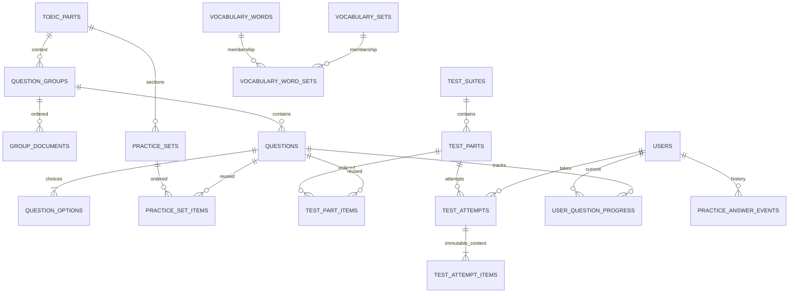

# Backend và database sau refactor

Ngày cập nhật: 24/10/2026. Phạm vi: nội dung TOEIC theo Part, luyện tập, thi từng Part, từ vựng, người dùng và xác thực. Các tính năng AI/import/shadowing trong tài liệu sản phẩm chưa được tạo thành bảng khi chưa có luồng nghiệp vụ sử dụng.

Danh sách đầy đủ sau V5: **32 bảng, 221 field**, chia theo module, kèm kiểu dữ liệu, ý nghĩa và ràng buộc: [DATABASE_SCHEMA.md](DATABASE_SCHEMA.md). Danh sách đã được đối chiếu trực tiếp với metadata của MySQL `toeic_clean`.

## Học liệu riêng của từng tài khoản

USER biên soạn tại `/workspace`: mục Listening/Reading, câu hỏi/ngữ cảnh, Category/Set/từ, nhập thủ công hoặc AI. Part 1–7 dùng chung và USER chỉ đọc. Backend kiểm tra người tạo ở list/chi tiết/ghi/membership/summary/AI; ADMIN không vượt quyền vào học liệu của người khác. Mô hình owner, endpoint, media riêng và xử lý legacy: [PRIVATE_WORKSPACE.md](PRIVATE_WORKSPACE.md).

## Mô hình đang chạy



- Câu hỏi chỉ nằm trong `questions`; đã bỏ entity/repository của ba ngân hàng nghe/đọc/thi cũ.
- Group chứa ngữ liệu độc lập với mục luyện tập: audio, đoạn nghe trong file dài, transcript, ảnh/biểu đồ và nhiều tài liệu đọc có thứ tự.
- Bộ luyện và Part của đề tham chiếu câu hỏi qua membership có vị trí. Có API gắn nguyên cụm. Bài luyện có thể lấy từng câu và vẫn nhận đủ ngữ cảnh; khi bắt đầu thi, server kiểm tra các cụm đầy đủ và liền nhau.
- Bảy Part là danh mục cố định. Mỗi Part có nhiều mục luyện tập, gồm `name`, `description` và audio tùy chọn; không giới hạn 1–5 và không có số cấp độ. Các mục sắp theo ID tạo tăng dần. Migration V2 giữ nguyên ID/membership/progress, đổi tên cột và bỏ ràng buộc cấp độ cũ.
- `question_options` biểu diễn số lựa chọn thực tế, đúng một đáp án; Part 2 có A/B/C. API đang làm bài không trả đáp án, giải thích hoặc transcript.
- `test_attempt_items.snapshot` là bản chụp nội dung, lựa chọn, đáp án, tài liệu và media tại start, được đánh dấu không cập nhật trong JPA. Phần chọn đáp án/đúng sai thuộc chính item của lần thi, không phụ thuộc câu gốc khi review/chấm.
- Archive nội dung/bộ luyện/đề/từ vựng; không cascade xóa sang progress, sự kiện trả lời hoặc kết quả thi.
- Từ vựng dùng quan hệ nhiều–nhiều với set; sửa từ không nhân bản nội dung. V3 bổ sung senses theo aim, đồng nghĩa/trái nghĩa/collocation theo sense và họ từ. Import ảnh/PDF/TXT trích từ tiếng Anh rồi tạo nội dung AI; bản đề xuất chưa ghi database, xác nhận sau khi duyệt mới lưu cả batch. `pronunciation` là phiên âm, `audio_url` dành cho audio. Hướng dẫn: [VOCABULARY_IMPORT.md](VOCABULARY_IMPORT.md).

## Module MVC

Code backend được tổ chức trong `com.example.toeic_api.modules`, với các tầng `controller`, `service`, `model`, `repository`, `dto/request`, `dto/response`, `mapper`, `config` theo nhu cầu của từng module. Cấu trúc chi tiết và quy tắc thêm tính năng: [PROJECT_STRUCTURE.md](toeic_api/PROJECT_STRUCTURE.md).

| Module | Trách nhiệm |
| --- | --- |
| `modules/auth` | Đăng nhập, phát hành/xác minh/thu hồi token, khôi phục mật khẩu |
| `modules/users` | Tài khoản, hồ sơ, quản trị role/enabled/authVersion, bootstrap admin |
| `modules/content` | Ngân hàng câu hỏi, ngữ liệu, lựa chọn, biên soạn và projection an toàn |
| `modules/practice` | Mục luyện tập, adapter Listening/Reading, membership, progress, bookmark, sự kiện và thống kê |
| `modules/tests` | Bộ đề, Part đề, membership, lần thi, snapshot, deadline, lịch sử phân trang, maintenance |
| `modules/vocabulary` | Chủ đề, bộ từ, từ, đồng nghĩa, collection và tiến độ học |
| `modules/ai` | DTO tạo lời giải, điều phối ngữ liệu trong ExplanationService và gọi Groq |
| `modules/media` | Upload, metadata private_media, kho file riêng và đọc file theo chủ sở hữu; giữ cấu hình Cloudinary cũ để tương thích |
| `modules/admin` | Tổng quan quản trị bằng các truy vấn thống kê |
| `shared` | Envelope API, xử lý lỗi, Clock UTC, base entity, cấu hình bảo mật/JWT |

Không còn các package controller/service/entity/repository/dto/mapper dùng chung ở root. DTO request/response nằm cùng module, không trả entity trực tiếp làm view. DTO đổi mật khẩu và tạo lời giải AI đã được đưa ra khỏi controller; logic chuẩn bị ngữ liệu AI thuộc service. Với backend REST, `dto/response` là dữ liệu cho giao diện React.

Đây là một ứng dụng Spring Boot với cấu trúc module theo package; các module vẫn chia sẻ database và một số quan hệ/dịch vụ nghiệp vụ. Package thay đổi không làm đổi URL HTTP, payload JSON, tên entity JPA hoặc bảng database. Không tạo migration mới cho việc chuyển package; giữ nguyên Flyway V1/V2 và class entry point.

## Quy tắc tiến độ và lần thi

1. Progress unique theo user/câu; bookmark là một boolean độc lập. Bookmark và reset không đổi thời điểm đã trả lời hoặc xóa event cũ.
2. Mỗi câu trả lời luyện thêm một event và cập nhật aggregate trong cùng transaction. Khóa user và unique key bảo vệ trường hợp hai request đầu tiên đồng thời; thao tác giữa các user độc lập.
3. Progress lưu cả phiên bản câu và phiên bản group. Khi nội dung đổi, progress hiện tại được xem là chưa trả lời, còn event và bookmark được giữ; truy vấn summary áp dụng cùng quy tắc.
4. Start/resume một lượt đang làm theo user/Part đề; unique active key và khóa transaction chống tạo trùng. Sau khi nộp có thể bắt đầu lượt khác.
5. `expires_at` do server đặt. Lưu nháp sau deadline bị từ chối ghi đáp án mới và chốt các lựa chọn đã lưu. Submit đến muộn cũng chỉ chấm lựa chọn đã lưu trước deadline.
6. Submit có khóa hàng và idempotency: retry trả cùng kết quả; không ghi lại đáp án đã nộp. Admin được xem kết quả nhưng không làm bài thay user.
7. Tác vụ maintenance chốt những lượt quá hạn theo batch 100 mỗi phút; kiểm tra deadline tại API vẫn hoạt động độc lập.
8. `score` trong response cũ là alias của `accuracyPercent` 0–100. Đây là tỷ lệ đúng cho bài theo Part.

Danh sách lịch sử phân trang, không tải CLOB của toàn bộ snapshot để đếm số câu. Số câu Part đề được đếm ở database; summary theo mục luyện tập chỉ trả aggregate thay vì toàn bộ câu hỏi. `open-in-view=false`, collection được batch fetch tối đa 50 khi cần.

## API chính và frontend

### Biên soạn theo cụm

`/admin/content` là trình soạn chung cho Listening, Reading và Đề thi. Bắt đầu với một câu; dấu cộng cho chọn thêm câu cùng ngữ cảnh hoặc mở ngữ cảnh mới độc lập. Bài đọc/audio được nhập ngay trong ngữ cảnh, không tạo Passage riêng. Có dán nhiều câu, đáp án radio, lời giải AI và xem trước. Part 6 cần đủ bốn câu/một bài đọc, Part 3–4 đủ ba câu/một audio trước khi lưu. API batch lưu tất cả ngữ cảnh và gắn vào bộ trong một transaction, kiểm tra Part, vị trí, cấu trúc, ID và version. Hướng dẫn và API: [CONTENT_AUTHORING.md](CONTENT_AUTHORING.md).

### Lời giải AI qua Groq

Các form quản trị ngân hàng nội dung, Listening, Reading và đề thi có nút **Tạo giải thích bằng AI**. Backend gọi [Groq Chat Completions](https://console.groq.com/docs/text-chat) bằng API key phía server; frontend không nhận key. Cấu hình trong biến môi trường hoặc `toeic_api/local.properties` riêng:

```properties
GROQ_API_KEY=<API key của bạn>
GROQ_MODEL=openai/gpt-oss-20b
GROQ_VOCABULARY_MODEL=openai/gpt-oss-120b
GROQ_VISION_MODEL=qwen/qwen3.8-27b
```

Model là cấu hình thay đổi được; đối chiếu [danh sách model Groq](https://console.groq.com/docs/models) theo tài khoản đang dùng. Khởi động lại backend sau khi đổi cấu hình. Chưa có key thì ứng dụng vẫn khởi động, nhưng yêu cầu tạo lời giải trả lỗi 503 rõ ràng.

Ngày 23/10/2026 đã xác minh API key local có quyền dùng `openai/gpt-oss-20b`; model cấu hình trước đây `llama-3.3-70b-versatile` trả `404 model_not_found`. Đã cập nhật model mặc định và cấu hình local sang `openai/gpt-oss-20b`. Danh sách thực sự của project có thể kiểm tra bằng `GET https://api.groq.com/openai/v1/models` với Bearer API key ở phía server; danh sách tài liệu công khai không bảo đảm mọi tài khoản có quyền dùng mọi model.

Client hiện phân biệt lỗi Groq: API key/quyền truy cập (8004), model không khả dụng (8005), timeout (8006), kết nối mạng (8007), phản hồi không hợp lệ (8008), đầu ra bị cắt (8009), request bị từ chối (8010), hạn mức (8002) và lỗi dịch vụ khác (8003). Lỗi API key của nhà cung cấp trả 503 cho frontend, không trả 401 khiến frontend tự refresh phiên người dùng. Log chỉ ghi HTTP status/nhóm lỗi hoặc loại lỗi kết nối; không đưa thông báo thô của Groq, API key hoặc prompt ra log/API. Đối chiếu HTTP status tại [Groq error codes](https://console.groq.com/docs/errors).

Với GPT-OSS, client gửi `reasoning_effort=low`, tối đa 4096 completion tokens. Kiểm tra lời giải/mẹo không rỗng, đúng đáp án chuẩn và thuộc các lựa chọn trước khi trả kết quả.

`POST /api/v1/workspace/content/explanations` dành cho người đăng nhập; alias `/api/v1/admin/content/explanations` dành cho ADMIN. groupId đã lưu phải thuộc người gọi. Payload gồm `partNumber`, `questionText`, `promptText`, `correctAnswer`, `options` dạng object A/B/C[/D], và tùy chọn `groupId`, `transcript`, `documents` dạng mảng `{title,content}`. Nếu có groupId, backend lấy ngữ liệu đã lưu; transcript/documents gửi trực tiếp được ưu tiên để hỗ trợ bản đang biên soạn. Không gửi thông tin tài khoản người học cho Groq.

API vẫn trả `{explanation}` dạng văn bản trong envelope chuẩn. Prompt hiện yêu cầu lời giải tự nhiên, thường 3–6 câu ngắn, nêu dấu hiệu chọn đáp án và một mẹo phù hợp. Part 5 tự phân biệt từ loại/ngữ pháp với câu cần hiểu nghĩa: câu từ loại ưu tiên vị trí và từ được bổ nghĩa, câu nghĩa ưu tiên ngữ cảnh/collocation và dịch phần liên quan. Chỉ phân biệt đáp án sai dễ nhầm; không bắt buộc phân tích từng đáp án hay chia bốn mục. Không tuyệt đối hóa mẹo theo vị trí/đuôi từ.

JSON nội bộ từ Groq gồm `correctAnswer`, `explanation`, `tip`; `translation` tùy chọn (chuỗi/null hoặc bỏ qua). Backend dựng văn bản “Chọn …”, “Mẹo: …” và chỉ thêm “Dịch: …” khi có. Vẫn từ chối sai đáp án, thiếu lời giải/mẹo, sai định dạng hoặc đầu ra bị cắt. Đây không phải sự bảo đảm AI luôn đúng về mặt kiến thức. Lời giải đã lưu/snapshot cũ giữ nguyên; muốn đổi văn phong cho câu cũ cần tạo lại bằng AI rồi lưu.

Kết quả điền vào form để xem trước; **nhấn Lưu** mới ghi vào `questions.explanation` bằng luồng hiện hữu. Không cần nhập tay hoặc thêm bảng/migration. Có thể sửa hoặc tạo lại. Học viên đọc lời giải đã lưu; lần thi mới chụp lời giải vào snapshot, snapshot của lần thi cũ giữ nguyên. Việc tạo bản nháp không đổi version/progress; việc lưu câu hỏi dùng quy tắc version hiện có.

Part 1/3/4 cần transcript; Part 6/7 cần văn bản bài đọc. Tính năng này không tự nghe URL audio, đọc URL ảnh hay OCR. Với đề chỉ có media, cần bổ sung ngữ liệu văn bản trong ngân hàng nội dung. Khi dữ liệu/đáp án mâu thuẫn, AI được yêu cầu từ chối thay vì bịa lập luận.

Kết nối tối đa 5 giây, mỗi yêu cầu tối đa 40 giây; giới hạn hai yêu cầu Groq đồng thời trên mỗi backend instance. HTTP 429 trả thông báo thử lại sau, không tự retry gây tăng chi phí. Gọi mạng sau khi đã sao chép ngữ liệu ra khỏi transaction. Không log API key, prompt hoặc nội dung lỗi thô từ nhà cung cấp.

Envelope giữ `{ code, message, result }`, thành công code 1000. Bearer JWT cho các API riêng tư.

| API | Ý nghĩa |
| --- | --- |
| `GET /api/v1/users/me` | Hồ sơ phiên hiện tại |
| `PUT /api/v1/users/me/password` | `{currentPassword,newPassword}`; đổi mật khẩu thu hồi các phiên cũ |
| `POST /api/v1/auth/forgot-password` | Gửi liên kết một lần; email không tồn tại vẫn trả xác nhận chung |
| `POST /api/v1/auth/reset-password` | `{token,newPassword}`; endpoint reset bằng userId đã bị loại bỏ |
| `GET /api/v1/{listening,reading}/sections/{partNumber}` | Danh sách mục: `{id,partId,name,description,audioUrl}` |
| `GET /api/v1/{listening,reading}/questions/section/{sectionId}` | Câu hỏi của mục luyện tập |
| `POST/PUT /api/v1/admin/{listening,reading}/sections[/{id}]` | `{partId,name,description,audioUrl?}`; tên bắt buộc, mô tả tùy chọn |
| `GET /api/v1/{listening,reading}/parts/{partNumber}/summary` | Summary theo mục luyện tập của người đăng nhập |
| `PATCH /api/v1/{listening,reading}/progress` | `{questionId,bookmarked}` hoặc `{questionId,status:"UNANSWERED"}` |
| `POST /api/v1/tests/start/{partId}` | Bắt đầu/tiếp tục attempt, trả snapshot an toàn và lựa chọn đã lưu |
| `PUT /api/v1/tests/attempts/{id}/answers` | Mảng `{questionId,selectedAnswer}` để lưu nháp |
| `POST /api/v1/tests/submit` | `{resultId,answers}`; chỉ owner được nộp |
| `GET /api/v1/tests/results?page=0&size=20` | `{items,page,size,totalElements,totalPages}`, size 1–100 |
| `GET /api/v1/tests/results/detail/{id}` | Owner hoặc ADMIN, review dùng snapshot |
| `GET /api/v1/admin/content/groups?partNumber=7` | Các group đang hoạt động |
| `POST /api/v1/admin/content/batches` | Lưu nhiều ngữ cảnh độc lập và gắn vào bộ trong một transaction |
| `POST/PUT /api/v1/admin/content/groups[/{id}]` | Ngữ liệu chung, nhiều documents, audio segment |
| `GET /api/v1/admin/content/groups/{id}/questions` | Câu trong group của người gọi, có đáp án cho người biên soạn |
| `POST/PUT /api/v1/admin/content/questions[/{id}]` | Câu hỏi và mảng options `{label,content,correct}` |
| `PUT /api/v1/admin/content/sets/{id}/groups/{groupId}` | `{position}`: gắn nguyên cụm vào bộ luyện |
| `PUT /api/v1/admin/content/test-parts/{id}/groups/{groupId}` | `{position}`: gắn nguyên cụm vào Part đề |
| `PUT /api/v1/admin/content/{sets,test-parts}/{id}/items` | `{questionId,position}`: tái sử dụng một câu |
| `DELETE /api/v1/admin/content/{sets,test-parts}/{id}/items/{questionId}` | Chỉ gỡ membership |
| `DELETE /api/v1/admin/content/{groups,questions}/{id}` | Archive nội dung chung |
| `PUT/DELETE /api/v1/admin/vocabulary/sets/{setId}/words/{wordId}` | Gắn/gỡ từ có sẵn khỏi set |

Các URL progress/result cũ có userId vẫn chỉ dùng danh tính từ phiên, không cho chọn tài khoản khác. API đọc câu hỏi admin riêng với learner; frontend admin không lấy đáp án từ API learner nữa. Lịch sử admin cũng dùng result phân trang; UI quản trị hiện hiển thị trang đầu 50 kết quả.

Màn `/admin/content` biên soạn group, nhiều đoạn đọc, audio segment, câu hỏi và gắn nguyên cụm vào các bộ cùng Part. Các trang quản trị hiện hữu vẫn dùng các adapter của ngân hàng chung. Trang thi khôi phục attempt, tự lưu lựa chọn, tính đồng hồ theo `expiresAt`, hiển thị tài liệu đọc và dùng snapshot khi xem lại. Part 2 render đúng ba lựa chọn.

## Cấu hình chạy mới

Yêu cầu Java 21, MySQL 8, Node phù hợp Vite hiện tại. Không có tài khoản `admin/admin` tự sinh và không để credential thật trong YAML.

Biến môi trường tối thiểu:

```text
DB_URL=jdbc:mysql://localhost:3306/toeic_clean?serverTimezone=UTC
DB_USERNAME=...
DB_PASSWORD=...
JWT_SIGNER_KEY=<chuỗi bí mật ngẫu nhiên tối thiểu 64 byte>
```

Tạo database trống trước; Flyway tạo bảng rồi Hibernate validate schema. Không dùng `ddl-auto:update`. Để tạo admin ban đầu, đặt `ADMIN_BOOTSTRAP_ENABLED=true`, `ADMIN_USERNAME`, `ADMIN_EMAIL`, `ADMIN_PASSWORD` tối thiểu 12 ký tự; tắt bootstrap sau khi đã tạo.

Cấu hình local có thể đặt `ADMIN_MIN_PASSWORD_LENGTH=8` để thử tài khoản với mật khẩu 8 ký tự. Mặc định vẫn là 12; backend không chấp nhận mức tối thiểu nhỏ hơn 8. Bootstrap chỉ tạo khi username chưa tồn tại, không đổi mật khẩu hoặc quyền của tài khoản đã có. Sau khi tạo, mật khẩu được lưu bằng BCrypt trong database.

Khi chạy local bằng IntelliJ, có thể copy `toeic_api/local.properties.example` thành `toeic_api/local.properties`, điền mật khẩu MySQL và JWT key. File này nằm ngoài `src`, được Git bỏ qua và tự nạp khi working directory là `toeic_api` hoặc thư mục gốc project. Không cần thêm profile hay đưa mật khẩu vào Run Configuration. Biến môi trường vẫn được ưu tiên nếu cùng tên. Profile `test` không nạp file local, nên kiểm thử không dùng credential hoặc database thật. File `.env` không được Spring Boot tự nạp.

Sinh JWT key ngẫu nhiên cho local bằng PowerShell, sau đó lưu kết quả vào `JWT_SIGNER_KEY` trong file riêng:

```powershell
[Convert]::ToBase64String([System.Security.Cryptography.RandomNumberGenerator]::GetBytes(64))
```

Nếu log báo MySQL `using password: NO`, ứng dụng chưa nhận mật khẩu: kiểm tra `DB_PASSWORD` trong file local hoặc biến môi trường của tiến trình IntelliJ. Nếu báo `Unknown database 'toeic_clean'`, tạo database trống bằng `CREATE DATABASE toeic_clean CHARACTER SET utf8mb4 COLLATE utf8mb4_unicode_ci;` trước khi chạy. `toeic_clean` là database cho schema mới; dữ liệu từ database cũ cần thực hiện quy trình chuyển đổi bên dưới. Không bật baseline để bỏ qua lỗi kết nối hoặc lỗi thiếu database.

Email recovery chỉ hoạt động khi có `PASSWORD_RESET_ENABLED=true`, `SMTP_HOST`, `SMTP_PORT`, credential SMTP, `SMTP_FROM`, `FRONTEND_URL`. Khi chưa cấu hình, API trả lỗi dịch vụ thay vì giả vờ đã gửi. Token reset 256 bit, database chỉ giữ hash SHA-256, hết hạn sau 20 phút và dùng một lần.

`JWT_VALID_HOURS` mặc định 1, `JWT_REFRESH_HOURS` mặc định 24. Decoder kiểm tra chữ ký, hạn, blacklist, enabled, role và authVersion ở mỗi request. Logout/refresh thu hồi JWT cũ; đổi mật khẩu, khóa user hoặc đổi role làm token cũ mất hiệu lực. Frontend cập nhật token từ refresh và dùng endpoint đổi mật khẩu có kiểm tra mật khẩu hiện tại.

Timestamp mới lưu UTC; response attempt có offset UTC. Frontend cũng hiểu các LocalDateTime khác theo quy ước UTC. Chạy sau khi export biến môi trường:

```powershell
cd toeic_api
.\mvnw.cmd spring-boot:run
```

## Chuyển database cũ

Migration chuyển dữ liệu legacy đã được chuẩn bị và kiểm thử trên fixture; chưa chạy chuyển đổi dữ liệu từ database cũ. Schema mới đã được tạo thành công trên database MySQL 8 `toeic_clean` riêng. MySQL DDL không bảo đảm rollback toàn transaction, nên cần kiểm chứng chuyển đổi legacy trên bản sao trước khi cutover.

1. Sao lưu database và thử restore; tạo một bản sao riêng để chạy migration. Dừng các tiến trình ghi từ backend cũ khi cutover thật.
2. Trỏ `DB_URL` vào bản sao. Khai báo `LEGACY_TIME_ZONE` theo múi giờ thực tế của ứng dụng cũ, ví dụ `Asia/Ho_Chi_Minh` nếu trước đây lưu giờ Việt Nam, hoặc `UTC` nếu đã lưu UTC. Không tự suy đoán múi giờ. Preflight sẽ dừng trước khi đổi tên bảng nếu thiếu giá trị này.
3. Kiểm tra các prerequisite preflight: email trùng sau chuẩn hóa, level/Part của dữ liệu legacy hoặc số câu trùng vị trí, quan hệ passage sai Part/level của dữ liệu legacy, default collection trùng và time limit không hợp lệ. Sửa dữ liệu nguồn có đối soát; không xóa tùy tiện để vượt constraint.
4. Chỉ cho lần chuyển schema legacy, đặt `FLYWAY_BASELINE_ON_MIGRATE=true`. Baseline version 0 cho phép V1 thực thi; mặc định tính năng này tắt để từ chối database không rỗng chưa có history.
5. V1 đổi tên bảng cũ thành `legacy_*`, tạo mô hình mới, sao chép và ánh xạ `(source_type, legacy_id) → new_id` trong `legacy_content_map`. Không drop bảng cũ và không gộp câu chỉ dựa vào nội dung giống nhau.
6. Tiến độ trùng được chọn theo thời điểm mới nhất, rồi theo ID để phân xử; dòng gốc vẫn trong bảng legacy. Không tạo giả lịch sử event mà hệ thống cũ chưa từng lưu. Email được chuẩn hóa; timestamp được chuyển từ múi giờ đã khai báo sang UTC.
7. Đối soát `migration_issues`: grouping audio Part 3/4 thiếu metadata cần được biên tập trong ngân hàng; đáp án cũ không hợp lệ được archive; snapshot kết quả cũ được tái dựng từ nội dung còn tồn tại lúc migration. Không thể phục hồi nội dung đã bị sửa/xóa trước đó chỉ từ schema cũ.
8. Kiểm tra số user/câu/membership, tiến độ, kết quả/answer, timestamp và các ID mapping. Kiểm tra lại toàn bộ luồng trên staging MySQL 8. Các JWT trước migration hết hiệu lực; đăng nhập lại.
9. Sau chuyển đổi thành công, tắt `FLYWAY_BASELINE_ON_MIGRATE`. Giữ bản sao và legacy tables đến khi hoàn tất đối soát. Nếu DDL thất bại giữa chừng, restore bản sao để thử lại; không bật `ddl-auto:update` hoặc xóa Flyway history để bỏ qua lỗi.

Các lượt legacy đã start không được tự chọn làm active attempt mới; vẫn được giữ trong lịch sử và xử lý deadline. Code và baseline schema được kiểm tra checksum Flyway; không sửa V1 sau khi đã triển khai, hãy thêm V2/V3.

## Kiểm chứng

Sau import từ vựng bằng ảnh/PDF/TXT: **63 test backend, 7 test frontend đạt**, lint/build đạt. V3 đã áp dụng trên MySQL, Hibernate validate và metadata 31 bảng/210 cột được đối chiếu. Đã gọi Groq thật cho ảnh song ngữ/PDF văn bản/PDF scan và kiểm tra Chrome desktop/mobile, gồm bước bắt buộc duyệt trước khi lưu. Chi tiết và giới hạn: [VOCABULARY_IMPORT.md](VOCABULARY_IMPORT.md).

Sau hợp nhất trình soạn: **47 test backend đạt**, gồm lưu Part 6 một bài/bốn câu, sửa giữ ID, từ chối cụm thiếu câu hoặc ID sai nguồn, rollback khi gắn bộ thất bại và tự thêm vào cuối bộ. Test batch kiểm tra hai bài đọc độc lập, giữ thứ tự khi sửa và rollback toàn bộ nếu ngữ cảnh thứ hai lỗi. **4 test parser frontend đạt**, frontend lint/build thành công. Không thêm bảng hoặc migration.

Sau điều chỉnh văn phong lời giải: bộ **41 test backend đạt**, gồm 13 test client Groq với lời giải/mẹo bắt buộc, dịch tùy chọn, kiểm tra đáp án và xử lý lỗi; đã chạy lại 13 test Groq sau khi bổ sung ví dụ vào prompt. Frontend lint/build thành công. Hai câu Part 5 mẫu (từ loại và nghĩa từ) đã gọi qua backend + Groq thật, nhận HTTP 200/code 1000 và lời giải ngắn bằng tiếng Việt. Không lưu câu mẫu vào database.

Sau sửa lỗi Groq ngày 23/10/2026: **40 test backend pass** (12 Groq client, 21 integration, 4 migration, 2 bootstrap admin, 1 context). Đã gọi thật qua backend riêng: đăng nhập admin rồi POST câu Part 5 mẫu vào `/api/v1/admin/content/explanations`, nhận HTTP 200/code 1000 và đủ bốn phần lời giải. Tiến trình kiểm tra đã dừng; cần khởi động lại backend đang dùng để nạp model mới. Không ghi câu mẫu vào database.

Sau tái cấu trúc module MVC ngày 23/10/2026: **35 test backend pass** qua `clean test` (21 integration, 4 migration, 7 Groq client, 2 bootstrap admin, 1 context). OpenAPI nhận đủ endpoint của 9 module. Backend đã khởi động trên MySQL local, Hibernate validate và đăng nhập admin thành công; Flyway xác nhận V1/V2 đã cập nhật, không cần migration mới. Frontend và hợp đồng API được giữ nguyên trong lần chuyển package này.

Ngày 23/10/2026, sau chuyển mục luyện tập: **34 test backend pass**, frontend lint/build thành công. Test kiểm tra V1 → V2 giữ ID/membership/progress, tạo hơn 5 mục trong một Part, response có name/description và kiểm tra tên bắt buộc. V2 đã áp dụng thành công trên MySQL `toeic_clean`, Hibernate validate và đăng nhập admin thành công. Metadata vẫn gồm 28 bảng, 192 cột; database local chưa có bộ luyện trước khi nâng cấp. V1 và fixture legacy được giữ nguyên để bảo toàn lịch sử migration.

Ngày 23/10/2026, sau tích hợp lời giải Groq: **30 test backend pass** (19 integration, 7 kiểm tra client Groq bằng HTTP server giả lập, 3 migration, 1 context). Frontend lint và production build thành công. Đã kiểm tra chặn learner gọi API tạo lời giải, thiếu ngữ liệu, sai nhãn/đáp án, JSON lỗi, phản hồi bị cắt, thiếu API key và HTTP 429. Chưa gọi Groq thật do chưa cấu hình API key.

Kết quả ngày 22/10/2026: clean build backend với **21 test pass** (17 integration, 3 migration, 1 context); frontend lint không có cảnh báo/lỗi và production build thành công. Maven Wrapper trên Windows cũng đã sửa lỗi đọc symlink target bị null và được dùng để chạy bộ test này.

```powershell
cd toeic_api
.\mvnw.cmd test
cd ../toeic_web
npm.cmd run lint
npm.cmd run build
```

Test profile dùng H2 riêng ở chế độ MySQL và chạy Flyway + Hibernate validate; không kết nối database local thật. Có integration test cho lựa chọn Part 2, context nhiều tài liệu, membership cùng Part, snapshot sau edit/archive, resume/draft/deadline, request đồng thời, bookmark/reset/version, uniqueness, quyền và token reset/thu hồi, từ vựng tái sử dụng; migration test cho schema trống, cutover, ID trùng nguồn, timezone và preflight an toàn.

Đã kiểm tra khởi động trên MySQL 8 thật với database mới `toeic_clean`: Flyway tạo schema thành công, Hibernate validate thành công, `GET /v3/api-docs` và `GET /api/v1/vocabulary/categories` trả HTTP 200. Metadata có 28 bảng, 192 cột. Database `toeic_db` cũ không bị thay đổi trong lần kiểm tra này.

Giới hạn xác minh: bộ 21 test tự động vẫn dùng H2; chưa chạy đầy đủ bộ test hoặc chuyển đổi dữ liệu legacy trên MySQL thật, chưa benchmark dữ liệu lớn hay chạy kiểm thử trình duyệt tự động. Không coi kết quả H2 hoặc kiểm tra khởi động schema trống là thay thế cho kiểm thử migration legacy trên staging MySQL.

Ngày 24/10/2026: học liệu riêng đã được kiểm tra bằng **71 test backend, 11 test frontend**, lint/build và Chrome desktop/mobile. V4/V5 đã áp dụng trên MySQL `toeic_clean`; Hibernate validate, đăng nhập admin và endpoint học liệu thành công. Metadata thực tế: **32 bảng/221 cột**. Dữ liệu cũ không rõ người tạo giữ nguyên và bị ẩn; không gán mặc định cho Admin.
