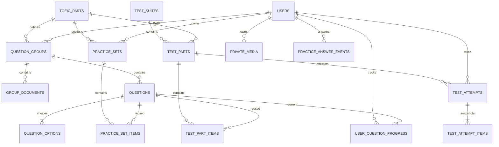

# Database hiện tại theo module

Đối chiếu trực tiếp `information_schema` của MySQL `toeic_clean` ngày 24/10/2026 sau V5: **32 bảng, 221 cột**. Nguồn đối chiếu trong code: [core-schema.sql](toeic_api/src/main/resources/db/core-schema.sql), [V1 migration](toeic_api/src/main/java/db/migration/V1__Canonical_learning_model.java), [V2 migration](toeic_api/src/main/java/db/migration/V2__Practice_sections.java), [V3 từ vựng](toeic_api/src/main/resources/db/migration/V3__Vocabulary_learning_content.sql), [V4 quyền sở hữu](toeic_api/src/main/java/db/migration/V4__Private_learning_workspace.java), [V5 media riêng](toeic_api/src/main/resources/db/migration/V5__Private_media.sql) và các entity/service hiện tại.

Đây là schema đang triển khai, không phải toàn bộ các bảng dự kiến trong tài liệu sản phẩm tương lai. Có **29 bảng nghiệp vụ** và **3 bảng kỹ thuật**. Các bảng `legacy_*` chỉ xuất hiện khi chuyển đổi database cũ; không nằm trong danh sách 32 bảng của database mới này.

| Module | Số bảng | Vai trò |
| --- | ---: | --- |
| Người dùng và xác thực | 3 | Tài khoản, thu hồi JWT, reset mật khẩu |
| Ngân hàng nội dung TOEIC | 5 | Bảy Part, ngữ liệu, câu hỏi và lựa chọn |
| Luyện tập và tiến độ câu hỏi | 4 | Mục luyện tập, thứ tự câu, tiến độ hiện tại, lịch sử trả lời |
| Đề thi và lần làm bài | 5 | Bộ đề, Part đề, lượt thi và snapshot |
| Ngân hàng từ vựng riêng | 8 | Chủ đề, bộ từ, từ, membership, nghĩa theo aim, cụm theo nghĩa và họ từ |
| Từ vựng cá nhân và tiến độ học | 3 | Collection riêng, từ đã lưu và tiến độ ôn |
| File ảnh/audio riêng | 1 | Metadata, chủ sở hữu và vị trí file riêng |
| Migration và vận hành schema | 3 | ID mapping, vấn đề legacy và Flyway history |

**Cách đọc:** PK = khóa chính; FK = khóa ngoại; UNIQUE = không trùng. Cột “NULL” ghi “Có” khi database cho phép bỏ trống. MySQL biểu diễn BOOLEAN bằng `tinyint(1)`. `datetime(6)` lưu thời gian có microsecond; backend quy ước UTC. “Tự tăng” chỉ áp dụng cho cột có `auto_increment`. `version` ở entity catalog/attempt là phiên bản khóa lạc quan; `auth_version` là phiên bản bảo mật; hai loại không thay thế nhau.

## Quyền sở hữu học liệu

Ngoại trừ danh mục Part cố định, học liệu chỉ hiện với người tạo; ADMIN cũng không xem/sửa học liệu của tài khoản khác. Backend gán chủ sở hữu theo JWT và kiểm tra ở cả API học lẫn biên soạn. Câu hỏi/document kế thừa quyền từ group; Set kế thừa từ Category. Membership chỉ được tạo giữa các đối tượng cùng chủ. Bản ghi legacy chưa xác định người tạo giữ NULL và bị ẩn, không bị xóa hay tự gán. Hướng dẫn, API và cách vận hành: [PRIVATE_WORKSPACE.md](PRIVATE_WORKSPACE.md).

## Quan hệ trung tâm

## 1. Người dùng và xác thực

### `users`

Tài khoản và trạng thái truy cập hệ thống.

| Field | Kiểu MySQL | NULL | Ý nghĩa |
| --- | --- | --- | --- |
| `id` (PK) | `varchar(255)` | Không | Khóa chính dạng chuỗi; backend tạo UUID cho tài khoản mới. |
| `username` | `varchar(255)` | Không | Tên đăng nhập, duy nhất. |
| `password` | `varchar(255)` | Không | Mật khẩu đã băm BCrypt; không lưu mật khẩu gốc. |
| `email` | `varchar(255)` | Không | Email tài khoản, duy nhất; dịch vụ chuẩn hóa trước khi lưu. |
| `full_name` | `varchar(255)` | Có | Tên hiển thị. |
| `role` | `varchar(32)` | Không | Vai trò USER hoặc ADMIN; lưu VARCHAR. |
| `enabled` | `tinyint(1)` | Không | Cho phép đăng nhập/sử dụng tài khoản; mặc định true. |
| `auth_version` | `bigint` | Không | Phiên bản xác thực. Tăng khi đổi mật khẩu, role hoặc trạng thái enabled để vô hiệu token cũ. |
| `created_at` | `datetime(6)` | Không | Thời điểm tạo, lưu theo UTC. |
| `updated_at` | `datetime(6)` | Có | Thời điểm cập nhật gần nhất, lưu theo UTC. |

**Quan hệ và quy tắc:** UNIQUE(username), UNIQUE(email). Một user có nhiều progress, lần thi và bộ sưu tập từ.

### `invalidated_tokens`

Danh sách token đã bị thu hồi khi logout/refresh.

| Field | Kiểu MySQL | NULL | Ý nghĩa |
| --- | --- | --- | --- |
| `id` (PK) | `varchar(255)` | Không | Khóa chính: jti của JWT bị thu hồi, không phải toàn bộ chuỗi JWT. |
| `expiry_time` | `datetime(6)` | Có | Thời điểm kết thúc thời gian cần chặn token, có xét cửa sổ refresh. |

**Quan hệ và quy tắc:** Có index expiry_time. JWT đang hợp lệ không cần một dòng riêng trong bảng này.

### `password_reset_tokens`

Token đặt lại mật khẩu, có hạn và chỉ dùng một lần.

| Field | Kiểu MySQL | NULL | Ý nghĩa |
| --- | --- | --- | --- |
| `token_hash` (PK) | `varchar(64)` | Không | PK: hash SHA-256 của token ngẫu nhiên; không lưu token gốc. |
| `user_id` | `varchar(255)` | Không | FK → users.id: người sở hữu hoặc người thực hiện. |
| `expires_at` | `datetime(6)` | Không | Thời điểm hết hạn; dịch vụ hiện cấp token có hạn 20 phút. |
| `used_at` | `datetime(6)` | Có | Thời điểm sử dụng thành công; NULL khi chưa dùng. |
| `auth_version` | `bigint` | Không | Phiên bản xác thực của user lúc cấp token; token cũ không dùng được sau khi phiên bản đổi. |

**Quan hệ và quy tắc:** FK user_id → users.id; index expires_at.

## 2. Ngân hàng nội dung TOEIC

### `toeic_parts`

Danh mục cố định Part 1–7, được dùng chung cho luyện và thi.

| Field | Kiểu MySQL | NULL | Ý nghĩa |
| --- | --- | --- | --- |
| `id` (PK) | `int` | Không | PK INT cố định từ 1 đến 7; không tự tăng. |
| `description` | `longtext` | Không | Tên/mô tả Part: Photographs, Question-Response, Conversations, Talks, Incomplete Sentences, Text Completion, Reading Comprehension. |

**Quan hệ và quy tắc:** CHECK(id BETWEEN 1 AND 7). Đây là loại Part, khác với một Part cụ thể trong một đề ở test_parts.

### `question_groups`

Ngữ liệu chung cho một hoặc nhiều câu: hội thoại, bài nói, ảnh hoặc cụm tài liệu đọc.

| Field | Kiểu MySQL | NULL | Ý nghĩa |
| --- | --- | --- | --- |
| `id` (PK, tự tăng) | `bigint` | Không | Khóa chính của bản ghi; BIGINT tự tăng trừ khi ghi chú riêng. |
| `owner_id` | `varchar(255)` | Có | FK → users.id: người tạo; dữ liệu mới bắt buộc do server gán. NULL chỉ dành cho legacy chưa xác định chủ và không được hiển thị. |
| `part_id` | `int` | Không | FK → toeic_parts.id: loại Part của cả nhóm. |
| `title` | `varchar(255)` | Có | Tên nhóm để biên soạn/quản trị. |
| `audio_url` | `varchar(255)` | Có | Đường dẫn file âm thanh; không lưu dữ liệu nhị phân audio trong bảng. |
| `image_url` | `varchar(255)` | Có | Đường dẫn ảnh/biểu đồ; không lưu dữ liệu nhị phân ảnh trong bảng. |
| `audio_start_ms` | `int` | Có | Vị trí bắt đầu đoạn nghe trong audio, đơn vị mili giây. |
| `audio_end_ms` | `int` | Có | Vị trí kết thúc đoạn nghe trong audio, đơn vị mili giây. |
| `transcript` | `longtext` | Có | Bản chép lời audio; thuộc dữ liệu lời giải. |
| `version` | `bigint` | Không | Phiên bản dùng optimistic locking: phát hiện cập nhật đồng thời. |
| `archived` | `tinyint(1)` | Không | Ẩn/ngừng sử dụng nội dung, mặc định false; giữ bản ghi và các quan hệ lịch sử. |
| `created_at` | `datetime(6)` | Không | Thời điểm tạo, lưu theo UTC. |
| `updated_at` | `datetime(6)` | Không | Thời điểm cập nhật gần nhất, lưu theo UTC. |

**Quan hệ và quy tắc:** Có index(owner_id, archived, id); chỉ chủ sở hữu được truy cập.  Index(part_id, archived). Hai mốc audio cùng NULL hoặc 0 ≤ start < end. Một group có nhiều questions và group_documents.

### `group_documents`

Các tài liệu đọc có thứ tự trong group; hỗ trợ nhiều email/thông báo/bài đọc hoặc ảnh.

| Field | Kiểu MySQL | NULL | Ý nghĩa |
| --- | --- | --- | --- |
| `group_id` (PK) | `bigint` | Không | FK → question_groups.id; đồng thời là thành phần PK. |
| `position` (PK) | `int` | Không | Thứ tự tài liệu trong group; đồng thời là thành phần PK. |
| `title` | `varchar(255)` | Có | Tiêu đề tài liệu. |
| `content` | `longtext` | Có | Nội dung văn bản của tài liệu. |
| `image_url` | `varchar(255)` | Có | Đường dẫn ảnh/biểu đồ; không lưu dữ liệu nhị phân ảnh trong bảng. |

**Quan hệ và quy tắc:** PK(group_id, position). position là thứ tự danh sách lưu trữ; không có CHECK bắt đầu từ 1.

### `questions`

Nội dung câu hỏi duy nhất, tái sử dụng cho bài luyện và bài thi.

`explanation` có thể được tạo qua Groq từ nút **Tạo giải thích bằng AI** trong form quản trị. Lời giải ngắn gọn, nêu dấu hiệu chọn đáp án và mẹo làm bài; chỉ dịch khi cần hiểu nghĩa. Part 5 phân biệt câu từ loại/ngữ pháp với câu nghĩa từ, không ép mọi câu theo bốn mục. API tạo bản nháp; nhấn Lưu mới ghi vào cột này. Lời giải/snapshot cũ giữ nguyên nếu chưa tạo lại. Không thêm bảng AI riêng và không gọi Groq mỗi lần học viên xem lời giải. Xem cấu hình tại [BACKEND_ARCHITECTURE.md](BACKEND_ARCHITECTURE.md).

| Field | Kiểu MySQL | NULL | Ý nghĩa |
| --- | --- | --- | --- |
| `id` (PK, tự tăng) | `bigint` | Không | Khóa chính của bản ghi; BIGINT tự tăng trừ khi ghi chú riêng. |
| `group_id` | `bigint` | Không | FK → question_groups.id: ngữ liệu và loại Part của câu. |
| `position` | `int` | Không | Thứ tự câu trong group, lớn hơn 0. |
| `question_text` | `longtext` | Có | Nội dung câu hỏi. |
| `prompt_text` | `longtext` | Có | Nội dung dẫn/chỉ dẫn bổ sung cho câu hỏi. |
| `explanation` | `longtext` | Có | Giải thích đáp án, không trả cho API đang làm bài. |
| `hide_question` | `tinyint(1)` | Không | Cờ điều khiển ẩn phần câu hỏi trên giao diện. |
| `version` | `bigint` | Không | Phiên bản dùng optimistic locking: phát hiện cập nhật đồng thời. |
| `archived` | `tinyint(1)` | Không | Ẩn/ngừng sử dụng nội dung, mặc định false; giữ bản ghi và các quan hệ lịch sử. |
| `created_at` | `datetime(6)` | Không | Thời điểm tạo, lưu theo UTC. |
| `updated_at` | `datetime(6)` | Không | Thời điểm cập nhật gần nhất, lưu theo UTC. |

**Quan hệ và quy tắc:** UNIQUE(group_id, position). Không có bảng câu hỏi Listening/Reading/Test riêng; Part được suy ra qua group.

### `question_options`

Các lựa chọn của câu hỏi và đáp án đúng.

| Field | Kiểu MySQL | NULL | Ý nghĩa |
| --- | --- | --- | --- |
| `question_id` (PK) | `bigint` | Không | FK → questions.id; đồng thời là thành phần PK. |
| `position` (PK) | `int` | Không | Thứ tự hiển thị lựa chọn; đồng thời là thành phần PK. |
| `label` | `varchar(1)` | Không | Nhãn A/B/C/D. |
| `content` | `longtext` | Có | Nội dung lựa chọn; có thể NULL. |
| `correct` | `tinyint(1)` | Không | Lựa chọn có phải đáp án đúng hay không. |

**Quan hệ và quy tắc:** PK(question_id, position), UNIQUE(question_id, label), CHECK(label IN A/B/C/D). Service kiểm tra Part 2 có 3 lựa chọn, các Part còn lại có 4, và đúng 1 đáp án; các điều kiện đếm này không được bảo đảm riêng bằng CHECK SQL.

## 3. Luyện tập và tiến độ câu hỏi

### `practice_sets`

Mục luyện tập thuộc một Part, có tên và mô tả tự do. Không giới hạn số mục mỗi Part.

| Field | Kiểu MySQL | NULL | Ý nghĩa |
| --- | --- | --- | --- |
| `id` (PK, tự tăng) | `bigint` | Không | Khóa chính của bản ghi; BIGINT tự tăng trừ khi ghi chú riêng. |
| `owner_id` | `varchar(255)` | Có | FK → users.id: người tạo; dữ liệu mới bắt buộc do server gán. NULL chỉ dành cho legacy chưa xác định chủ và không được hiển thị. |
| `part_id` | `int` | Không | FK → toeic_parts.id. |
| `name` | `varchar(255)` | Không | Tên mục luyện tập; bắt buộc, tối đa 255 ký tự. |
| `description` | `longtext` | Có | Mô tả nội dung/mục tiêu của mục luyện tập; API giới hạn 10.000 ký tự. |
| `audio_url` | `varchar(255)` | Có | Audio chung cho bộ luyện nếu có; group vẫn có thể có audio riêng. |
| `version` | `bigint` | Không | Phiên bản dùng optimistic locking: phát hiện cập nhật đồng thời. |
| `archived` | `tinyint(1)` | Không | Ẩn/ngừng sử dụng nội dung, mặc định false; giữ bản ghi và các quan hệ lịch sử. |
| `created_at` | `datetime(6)` | Không | Thời điểm tạo, lưu theo UTC. |
| `updated_at` | `datetime(6)` | Không | Thời điểm cập nhật gần nhất, lưu theo UTC. |

**Quan hệ và quy tắc:** Có index(owner_id, archived, id); chỉ chủ sở hữu được truy cập.  FK part_id → toeic_parts.id. Index(part_id, archived, id). Không còn UNIQUE theo số cấp độ hoặc CHECK 1–5; mỗi Part có thể có nhiều mục. Mục được sắp theo ID tăng dần. V2 giữ tên cũ và các ID, bổ sung description ban đầu NULL.

### `practice_set_items`

Gắn câu hỏi có sẵn vào bộ luyện và xác định thứ tự.

| Field | Kiểu MySQL | NULL | Ý nghĩa |
| --- | --- | --- | --- |
| `id` (PK, tự tăng) | `bigint` | Không | Khóa chính của bản ghi; BIGINT tự tăng trừ khi ghi chú riêng. |
| `set_id` | `bigint` | Không | FK → practice_sets.id. |
| `question_id` | `bigint` | Không | FK → questions.id: câu hỏi trong ngân hàng chung. |
| `position` | `int` | Không | Vị trí câu trong bộ luyện, lớn hơn 0. |

**Quan hệ và quy tắc:** UNIQUE(set_id, position), UNIQUE(set_id, question_id). Service chỉ cho gắn câu cùng loại Part và cùng chủ sở hữu. Một câu có thể được gắn vào nhiều bộ.

### `user_question_progress`

Trạng thái hiện tại của một user đối với một câu, dùng cho giao diện và thống kê.

| Field | Kiểu MySQL | NULL | Ý nghĩa |
| --- | --- | --- | --- |
| `id` (PK, tự tăng) | `bigint` | Không | Khóa chính của bản ghi; BIGINT tự tăng trừ khi ghi chú riêng. |
| `user_id` | `varchar(255)` | Không | FK → users.id: người sở hữu hoặc người thực hiện. |
| `question_id` | `bigint` | Không | FK → questions.id: câu hỏi trong ngân hàng chung. |
| `selected_answer` | `varchar(255)` | Có | Nhãn lựa chọn A/B/C/D; NULL nếu chưa chọn hoặc đã reset, khi cột cho phép NULL. |
| `question_version` | `bigint` | Không | Phiên bản câu hỏi tại lần trả lời. |
| `group_version` | `bigint` | Không | Phiên bản ngữ liệu chung tại lần trả lời. |
| `correct` | `tinyint(1)` | Có | Kết quả lần trả lời hiện tại: true/false; NULL khi chưa trả lời hoặc đã reset. |
| `bookmarked` | `tinyint(1)` | Không | Đánh dấu câu cần lưu/ôn lại; độc lập với đúng/sai. |
| `attempt_count` | `bigint` | Không | Tổng số lần đã trả lời câu qua chức năng luyện. |
| `last_answered_at` | `datetime(6)` | Có | Thời điểm trả lời gần nhất; bookmark/reset không ghi đè thời điểm này. |

**Quan hệ và quy tắc:** UNIQUE(user_id, question_id), index(user_id, last_answered_at). Tiến độ dùng chung khi câu xuất hiện ở nhiều bộ; không tách theo set. Khi version câu/group đổi, kết quả hiện tại được xem là chưa trả lời, còn bookmark và lịch sử được giữ.

### `practice_answer_events`

Nhật ký mỗi lần trả lời luyện tập, bổ sung bản ghi theo từng lần trả lời.

| Field | Kiểu MySQL | NULL | Ý nghĩa |
| --- | --- | --- | --- |
| `id` (PK, tự tăng) | `bigint` | Không | Khóa chính của bản ghi; BIGINT tự tăng trừ khi ghi chú riêng. |
| `user_id` | `varchar(255)` | Không | FK → users.id: người sở hữu hoặc người thực hiện. |
| `question_id` | `bigint` | Không | FK → questions.id: câu hỏi trong ngân hàng chung. |
| `question_version` | `bigint` | Không | Phiên bản câu hỏi tại lần trả lời. |
| `group_version` | `bigint` | Không | Phiên bản ngữ liệu chung tại lần trả lời. |
| `selected_answer` | `varchar(255)` | Không | Nhãn lựa chọn A/B/C/D; NULL nếu chưa chọn hoặc đã reset, khi cột cho phép NULL. |
| `correct` | `tinyint(1)` | Không | Kết quả đúng/sai tại thời điểm trả lời. |
| `answered_at` | `datetime(6)` | Không | Thời điểm gửi câu trả lời, UTC. |

**Quan hệ và quy tắc:** Index(user_id, answered_at). Reset progress không xóa event. Bảng lưu lựa chọn, kết quả và version, không lưu snapshot đầy đủ nội dung như lần thi.

## 4. Đề thi và lần làm bài

### `test_suites`

Danh mục bộ đề, chứa các Part cụ thể của đề.

| Field | Kiểu MySQL | NULL | Ý nghĩa |
| --- | --- | --- | --- |
| `id` (PK, tự tăng) | `bigint` | Không | Khóa chính của bản ghi; BIGINT tự tăng trừ khi ghi chú riêng. |
| `owner_id` | `varchar(255)` | Có | FK → users.id: người tạo; dữ liệu mới bắt buộc do server gán. NULL chỉ dành cho legacy chưa xác định chủ và không được hiển thị. |
| `suite_name` | `varchar(255)` | Không | Tên bộ đề, duy nhất. |
| `description` | `longtext` | Có | Mô tả bộ đề. |
| `source` | `varchar(255)` | Có | Nguồn/xuất xứ bộ đề. |
| `version` | `bigint` | Không | Phiên bản dùng optimistic locking: phát hiện cập nhật đồng thời. |
| `archived` | `tinyint(1)` | Không | Ẩn/ngừng sử dụng nội dung, mặc định false; giữ bản ghi và các quan hệ lịch sử. |
| `created_at` | `datetime(6)` | Không | Thời điểm tạo, lưu theo UTC. |
| `updated_at` | `datetime(6)` | Không | Thời điểm cập nhật gần nhất, lưu theo UTC. |

**Quan hệ và quy tắc:** Có index(owner_id, archived, id); chỉ chủ sở hữu được truy cập.  UNIQUE(suite_name). Một suite chứa nhiều test_parts; lượt làm bài hiện được tạo theo từng test_part.

### `test_parts`

Một Part cụ thể thuộc một bộ đề, có thời gian và danh sách câu riêng.

| Field | Kiểu MySQL | NULL | Ý nghĩa |
| --- | --- | --- | --- |
| `id` (PK, tự tăng) | `bigint` | Không | Khóa chính của bản ghi; BIGINT tự tăng trừ khi ghi chú riêng. |
| `suite_id` | `bigint` | Không | FK → test_suites.id. |
| `toeic_part_id` | `int` | Không | FK → toeic_parts.id: loại Part 1–7. |
| `time_limit` | `int` | Không | Giới hạn làm bài, đơn vị phút, phải lớn hơn 0. |
| `audio_url` | `varchar(255)` | Có | Audio chung của Part trong đề nếu có. |
| `version` | `bigint` | Không | Phiên bản dùng optimistic locking: phát hiện cập nhật đồng thời. |
| `archived` | `tinyint(1)` | Không | Ẩn/ngừng sử dụng nội dung, mặc định false; giữ bản ghi và các quan hệ lịch sử. |
| `created_at` | `datetime(6)` | Không | Thời điểm tạo, lưu theo UTC. |
| `updated_at` | `datetime(6)` | Không | Thời điểm cập nhật gần nhất, lưu theo UTC. |

**Quan hệ và quy tắc:** UNIQUE(suite_id, toeic_part_id), CHECK(time_limit > 0). Số câu được tính từ test_part_items, không có cột question_count.

### `test_part_items`

Gắn câu từ ngân hàng chung vào một Part của đề.

| Field | Kiểu MySQL | NULL | Ý nghĩa |
| --- | --- | --- | --- |
| `id` (PK, tự tăng) | `bigint` | Không | Khóa chính của bản ghi; BIGINT tự tăng trừ khi ghi chú riêng. |
| `part_id` | `bigint` | Không | FK → test_parts.id; không phải toeic_parts.id. |
| `question_id` | `bigint` | Không | FK → questions.id: câu hỏi trong ngân hàng chung. |
| `position` | `int` | Không | Vị trí câu trong Part của đề, lớn hơn 0. |

**Quan hệ và quy tắc:** UNIQUE(part_id, position), UNIQUE(part_id, question_id). Service kiểm tra cùng Part, và ngữ liệu đủ/liền nhóm khi bắt đầu thi.

### `test_attempts`

Một lần làm bài của một user đối với một test_part; chứa deadline và kết quả tổng hợp.

| Field | Kiểu MySQL | NULL | Ý nghĩa |
| --- | --- | --- | --- |
| `id` (PK, tự tăng) | `bigint` | Không | Khóa chính của bản ghi; BIGINT tự tăng trừ khi ghi chú riêng. |
| `version` | `bigint` | Không | Phiên bản dùng optimistic locking: phát hiện cập nhật đồng thời. |
| `user_id` | `varchar(255)` | Không | FK → users.id: người sở hữu hoặc người thực hiện. |
| `part_id` | `bigint` | Không | FK → test_parts.id: Part cụ thể của đề được làm. |
| `active_key` | `varchar(100)` | Có | Khóa duy nhất cho lượt đang làm theo user/Part đề; chuyển NULL khi nộp để cho phép lượt mới. |
| `status` | `varchar(255)` | Không | SQL cho phép IN_PROGRESS, SUBMITTED, REVIEWED; luồng hiện tại chuyển IN_PROGRESS → SUBMITTED khi chốt bài. |
| `started_at` | `datetime(6)` | Không | Thời điểm bắt đầu, UTC. |
| `expires_at` | `datetime(6)` | Không | Deadline do server đặt, UTC. |
| `submitted_at` | `datetime(6)` | Có | Thời điểm chốt/nộp bài; NULL khi đang làm. |
| `total_count` | `int` | Không | Số câu được chốt tại thời điểm bắt đầu. |
| `time_spent` | `int` | Có | Thời gian làm bài, đơn vị giây. |
| `correct_count` | `int` | Có | Số câu đúng sau khi chấm. |
| `accuracy_percent` | `int` | Có | Tỷ lệ đúng 0–100; không phải thang điểm TOEIC 10–990. |
| `part_number` | `int` | Không | Số Part được chụp tại lúc bắt đầu, giúp lịch sử không đổi khi biên soạn đề. |
| `suite_name` | `varchar(255)` | Không | Tên bộ đề được chụp tại lúc bắt đầu. |
| `audio_url` | `varchar(255)` | Có | Audio của Part được chụp tại lúc bắt đầu. |

**Quan hệ và quy tắc:** UNIQUE(active_key), index(user_id, started_at), index(status, expires_at). version bảo vệ cập nhật đồng thời. Đây là lượt thi từng Part, chưa có lượt thi full test bao trùm nhiều Part.

### `test_attempt_items`

Câu hỏi và đáp án người dùng trong một lần thi; hỗ trợ lưu nháp, chấm và xem lại.

| Field | Kiểu MySQL | NULL | Ý nghĩa |
| --- | --- | --- | --- |
| `id` (PK, tự tăng) | `bigint` | Không | Khóa chính của bản ghi; BIGINT tự tăng trừ khi ghi chú riêng. |
| `attempt_id` | `bigint` | Không | FK → test_attempts.id. |
| `question_id` | `bigint` | Không | FK → questions.id: tham chiếu nguồn; khi chấm/xem lại dùng snapshot. |
| `position` | `int` | Không | Vị trí câu trong lần thi, được chốt tại lúc bắt đầu. |
| `snapshot` | `longtext` | Không | JSON lưu trong LONGTEXT: nội dung câu, lựa chọn, đáp án đúng, giải thích, ngữ liệu và media tại lúc bắt đầu. JPA không cập nhật cột này. |
| `selected_answer` | `varchar(255)` | Có | Nhãn lựa chọn A/B/C/D; NULL nếu chưa chọn hoặc đã reset, khi cột cho phép NULL. |
| `correct` | `tinyint(1)` | Có | Kết quả sau khi chấm; NULL khi chưa chấm. |
| `answered_at` | `datetime(6)` | Có | Thời điểm cập nhật lựa chọn gần nhất, UTC. |

**Quan hệ và quy tắc:** UNIQUE(attempt_id, position), UNIQUE(attempt_id, question_id). Đáp án đúng trong snapshot chỉ dùng phía server hoặc trả khi được xem lời giải; không lộ trong API đang thi. Archive câu gốc không làm mất snapshot.

## 5. Ngân hàng từ vựng riêng

### `vocabulary_categories`

Chủ đề/phân loại bộ từ vựng.

| Field | Kiểu MySQL | NULL | Ý nghĩa |
| --- | --- | --- | --- |
| `id` (PK, tự tăng) | `bigint` | Không | Khóa chính của bản ghi; BIGINT tự tăng trừ khi ghi chú riêng. |
| `category_name` | `varchar(255)` | Không | Tên chủ đề, duy nhất trong một tài khoản. |
| `description` | `longtext` | Có | Mô tả chủ đề. |
| `created_by` | `varchar(255)` | Có | FK → users.id: chủ sở hữu Category; server gán khi tạo. NULL legacy bị ẩn. |
| `created_at` | `datetime(6)` | Không | Thời điểm tạo, lưu theo UTC. |
| `updated_at` | `datetime(6)` | Có | Thời điểm cập nhật gần nhất, lưu theo UTC. |
| `archived` | `tinyint(1)` | Không | Ẩn/ngừng sử dụng nội dung, mặc định false; giữ bản ghi và các quan hệ lịch sử. |

**Quan hệ và quy tắc:** UNIQUE(created_by, category_name). Một category có nhiều vocabulary_sets.

### `vocabulary_sets`

Bộ từ vựng thuộc một chủ đề.

| Field | Kiểu MySQL | NULL | Ý nghĩa |
| --- | --- | --- | --- |
| `id` (PK, tự tăng) | `bigint` | Không | Khóa chính của bản ghi; BIGINT tự tăng trừ khi ghi chú riêng. |
| `category_id` | `bigint` | Không | FK → vocabulary_categories.id. |
| `set_name` | `varchar(255)` | Không | Tên bộ từ. |
| `description` | `longtext` | Có | Mô tả bộ từ. |
| `created_at` | `datetime(6)` | Không | Thời điểm tạo, lưu theo UTC. |
| `updated_at` | `datetime(6)` | Có | Thời điểm cập nhật gần nhất, lưu theo UTC. |
| `archived` | `tinyint(1)` | Không | Ẩn/ngừng sử dụng nội dung, mặc định false; giữ bản ghi và các quan hệ lịch sử. |

**Quan hệ và quy tắc:** Quyền sở hữu kế thừa từ category.created_by; không chuyển sang Category của người khác. Từ nằm trong bộ qua vocabulary_word_sets, không có cột set_id trong vocabulary_words.

### `vocabulary_words`

Thông tin từ vựng của một người tạo, tái sử dụng giữa nhiều bộ của cùng tài khoản.

| Field | Kiểu MySQL | NULL | Ý nghĩa |
| --- | --- | --- | --- |
| `id` (PK, tự tăng) | `bigint` | Không | Khóa chính của bản ghi; BIGINT tự tăng trừ khi ghi chú riêng. |
| `owner_id` | `varchar(255)` | Có | FK → users.id: người tạo; dữ liệu mới bắt buộc do server gán. NULL chỉ dành cho legacy chưa xác định chủ và không được hiển thị. |
| `word` | `varchar(255)` | Không | Từ/cụm từ tiếng Anh. |
| `meaning` | `longtext` | Không | Nghĩa của từ. |
| `part_of_speech` | `varchar(255)` | Không | Loại từ: danh từ, động từ, tính từ… |
| `example_sentence` | `longtext` | Có | Câu ví dụ tiếng Anh. |
| `example_translation` | `longtext` | Có | Bản dịch câu ví dụ. |
| `pronunciation` | `varchar(255)` | Có | Phiên âm; khác với audio_url là đường dẫn âm thanh. |
| `audio_url` | `varchar(255)` | Có | Đường dẫn file âm thanh; không lưu dữ liệu nhị phân audio trong bảng. |
| `created_at` | `datetime(6)` | Không | Thời điểm tạo, lưu theo UTC. |
| `updated_at` | `datetime(6)` | Có | Thời điểm cập nhật gần nhất, lưu theo UTC. |
| `archived` | `tinyint(1)` | Không | Ẩn/ngừng sử dụng nội dung, mặc định false; giữ bản ghi và các quan hệ lịch sử. |

**Quan hệ và quy tắc:** Có index(owner_id, archived, id); chỉ chủ sở hữu được truy cập.  Một word có nhiều sense, họ từ và thuộc nhiều set. Các cột meaning/part_of_speech/example của word là bản tương thích của nghĩa đầu tiên; nguồn nội dung nhiều nghĩa nằm trong vocabulary_senses. word không có UNIQUE toàn cục; luồng import khóa bộ nhận và kiểm tra từ trùng trong bộ trước khi thêm, không tự ghi đè nội dung đã có.

### `vocabulary_word_sets`

Quan hệ nhiều–nhiều giữa từ và bộ từ.

| Field | Kiểu MySQL | NULL | Ý nghĩa |
| --- | --- | --- | --- |
| `word_id` (PK) | `bigint` | Không | FK → vocabulary_words.id; đồng thời là thành phần PK. |
| `set_id` (PK) | `bigint` | Không | FK → vocabulary_sets.id; đồng thời là thành phần PK. |

**Quan hệ và quy tắc:** PK(word_id, set_id), index(set_id, word_id). Chỉ gắn từ và Set cùng chủ sở hữu. Gỡ từ khỏi một bộ chỉ xóa membership, không xóa từ dùng chung.

### `vocabulary_synonyms`

Các từ/cụm từ đồng nghĩa của một từ vựng.

| Field | Kiểu MySQL | NULL | Ý nghĩa |
| --- | --- | --- | --- |
| `id` (PK, tự tăng) | `bigint` | Không | Khóa chính của bản ghi; BIGINT tự tăng trừ khi ghi chú riêng. |
| `word_id` | `bigint` | Không | FK → vocabulary_words.id: từ vựng dùng chung. |
| `synonym_phrase` | `longtext` | Không | Nội dung từ/cụm từ đồng nghĩa. |
| `created_at` | `datetime(6)` | Không | Thời điểm tạo, lưu theo UTC. |

**Quan hệ và quy tắc:** FK word_id → vocabulary_words.id. Mỗi synonym là một dòng, không phải chuỗi nối bằng dấu phẩy.

### `vocabulary_senses`

Từng nghĩa và từ loại của một từ, kèm ngưỡng aim do AI/người biên soạn đề xuất. Aim không phải phân loại điểm chính thức của ETS.

| Field | Kiểu MySQL | NULL | Ý nghĩa |
| --- | --- | --- | --- |
| `id` (PK, tự tăng) | `bigint` | Không | ID nghĩa. |
| `word_id` (FK) | `bigint` | Không | → vocabulary_words.id. |
| `position` | `int` | Không | Thứ tự nghĩa trong từ; UNIQUE(word_id, position). |
| `meaning` | `longtext` | Không | Nghĩa tiếng Việt. |
| `part_of_speech` | `varchar(255)` | Không | Từ loại tương ứng nghĩa này. |
| `minimum_target_score` | `int` | Có | Mốc ưu tiên học 10–990; NULL nếu chưa phân loại. |
| `example_sentence` | `longtext` | Có | Câu ví dụ tiếng Anh cho nghĩa này. |
| `example_translation` | `longtext` | Có | Dịch ví dụ sang tiếng Việt. |
| `study_note` | `longtext` | Có | Gợi ý học nghĩa này trong TOEIC. |

V3 tạo một sense từ nghĩa/ví dụ cũ và để ngưỡng aim NULL, không tự gán level cho dữ liệu chưa được duyệt. Mốc aim phục vụ biên soạn nội dung AI. Trang học từ đã bỏ thanh chọn aim và hiển thị toàn bộ nghĩa được biên soạn qua các tab của flashcard.

### `vocabulary_sense_phrases`

Đồng nghĩa, trái nghĩa và collocation được gắn đúng từng nghĩa, không trộn tất cả nghĩa của từ.

| Field | Kiểu MySQL | NULL | Ý nghĩa |
| --- | --- | --- | --- |
| `sense_id` (PK, FK) | `bigint` | Không | → vocabulary_senses.id. |
| `position` (PK) | `int` | Không | Thứ tự mục trong sense. |
| `kind` | `varchar(20)` | Không | SYNONYM, ANTONYM hoặc COLLOCATION; có CHECK. |
| `phrase` | `varchar(300)` | Không | Từ/cụm từ, có thể kèm nghĩa ngắn. |

Không có trái nghĩa/collocation thì không tạo dòng; API trả mảng rỗng. Bảng vocabulary_synonyms cũ được giữ tương thích; API dùng đồng nghĩa cũ cho nghĩa đầu tiên nếu chưa có mục theo sense.

### `vocabulary_word_family`

Họ từ phái sinh của từ gốc; không phải quan hệ đồng nghĩa.

| Field | Kiểu MySQL | NULL | Ý nghĩa |
| --- | --- | --- | --- |
| `word_id` (PK, FK) | `bigint` | Không | → vocabulary_words.id. |
| `position` (PK) | `int` | Không | Thứ tự từ cùng họ. |
| `family_word` | `varchar(100)` | Không | Từ cùng họ, ví dụ chargeable. |
| `part_of_speech` | `varchar(40)` | Có | Từ loại của từ cùng họ. |
| `meaning` | `varchar(500)` | Có | Nghĩa tiếng Việt. |

Không có họ từ thì không tạo dòng. Import AI chỉ tạo bản đề xuất trong bộ nhớ; người biên soạn phải duyệt và xác nhận trước khi ghi các bảng trên. Chi tiết: [VOCABULARY_IMPORT.md](VOCABULARY_IMPORT.md).

## 6. Từ vựng cá nhân và tiến độ học

### `user_vocabulary_collection`

Bộ sưu tập từ riêng của user; có một bộ mặc định và có thể có các bộ khác.

| Field | Kiểu MySQL | NULL | Ý nghĩa |
| --- | --- | --- | --- |
| `id` (PK, tự tăng) | `bigint` | Không | Khóa chính của bản ghi; BIGINT tự tăng trừ khi ghi chú riêng. |
| `user_id` | `varchar(255)` | Không | FK → users.id: người sở hữu hoặc người thực hiện. |
| `set_name` | `varchar(255)` | Không | Tên bộ sưu tập cá nhân. |
| `is_default` | `tinyint(1)` | Không | Đánh dấu bộ mặc định. |
| `created_at` | `datetime(6)` | Không | Thời điểm tạo, lưu theo UTC. |
| `default_owner` (cột sinh) | `varchar(255)` | Có | Cột sinh tự động: user_id nếu is_default=true, còn lại NULL. Không nhập trực tiếp từ API. |

**Quan hệ và quy tắc:** UNIQUE(default_owner) bảo đảm mỗi user có tối đa một bộ mặc định; vẫn cho phép nhiều bộ không mặc định. Cột default_owner được migration thêm sau core-schema.sql.

### `user_vocabulary_items`

Các từ user lưu vào từng bộ sưu tập riêng.

| Field | Kiểu MySQL | NULL | Ý nghĩa |
| --- | --- | --- | --- |
| `id` (PK, tự tăng) | `bigint` | Không | Khóa chính của bản ghi; BIGINT tự tăng trừ khi ghi chú riêng. |
| `collection_id` | `bigint` | Không | FK → user_vocabulary_collection.id. |
| `word_id` | `bigint` | Không | FK → vocabulary_words.id: từ vựng dùng chung. |
| `added_at` | `datetime(6)` | Không | Thời điểm lưu từ vào bộ, UTC. |

**Quan hệ và quy tắc:** UNIQUE(collection_id, word_id). Lưu cùng từ ở hai collection khác nhau được phép.

### `user_vocabulary_progress`

Tiến độ học một từ của một user, dùng chung giữa các collection.

| Field | Kiểu MySQL | NULL | Ý nghĩa |
| --- | --- | --- | --- |
| `id` (PK, tự tăng) | `bigint` | Không | Khóa chính của bản ghi; BIGINT tự tăng trừ khi ghi chú riêng. |
| `user_id` | `varchar(255)` | Không | FK → users.id: người sở hữu hoặc người thực hiện. |
| `word_id` | `bigint` | Không | FK → vocabulary_words.id: từ vựng dùng chung. |
| `status` | `varchar(255)` | Không | Trạng thái LEARNING, REVIEWING hoặc MASTERED; lưu VARCHAR. |
| `last_reviewed` | `datetime(6)` | Có | Thời điểm ôn gần nhất, UTC. |
| `review_count` | `int` | Không | Số lần ôn đã ghi nhận, mặc định 0. |

**Quan hệ và quy tắc:** UNIQUE(user_id, word_id). Hiện chưa có các field của thuật toán lặp lại ngắt quãng như next_review_at, ease_factor, interval_days.

## 7. Migration và vận hành schema

### `legacy_content_map`

Đối chiếu ID nguồn cũ với ID mới trong quá trình chuyển đổi.

| Field | Kiểu MySQL | NULL | Ý nghĩa |
| --- | --- | --- | --- |
| `source_type` (PK) | `varchar(50)` | Không | Loại nguồn cũ, giúp phân biệt các bảng có ID trùng nhau; thành phần PK. |
| `legacy_id` (PK) | `bigint` | Không | ID cũ; thành phần PK. |
| `new_id` | `bigint` | Không | ID trong mô hình mới; đích phụ thuộc source_type, không có FK SQL cố định. |

**Quan hệ và quy tắc:** PK(source_type, legacy_id). Không tham gia luồng làm bài thông thường.

### `migration_issues`

Ghi lại dữ liệu legacy cần đối soát hoặc biên tập sau chuyển đổi.

| Field | Kiểu MySQL | NULL | Ý nghĩa |
| --- | --- | --- | --- |
| `id` (PK, tự tăng) | `bigint` | Không | Khóa chính của bản ghi; BIGINT tự tăng trừ khi ghi chú riêng. |
| `source_type` | `varchar(50)` | Không | Loại dữ liệu nguồn. |
| `legacy_id` | `bigint` | Có | ID nguồn nếu có. |
| `detail` | `varchar(1000)` | Không | Nội dung vấn đề hoặc ghi chú đối soát. |

**Quan hệ và quy tắc:** Ví dụ: thiếu thông tin nhóm audio, đáp án không hợp lệ, giới hạn khôi phục snapshot lịch sử.

### `flyway_schema_history`

Bảng Flyway tự quản lý, theo dõi migration đã thực thi.

| Field | Kiểu MySQL | NULL | Ý nghĩa |
| --- | --- | --- | --- |
| `installed_rank` (PK) | `int` | Không | PK: thứ tự migration được ghi nhận; không phải ID tự tăng do domain quản lý. |
| `version` | `varchar(50)` | Có | Phiên bản migration; có thể NULL với loại migration không có version. |
| `description` | `varchar(200)` | Không | Mô tả migration. |
| `type` | `varchar(20)` | Không | Loại migration, ví dụ JDBC cho Java migration. |
| `script` | `varchar(1000)` | Không | Tên script/class migration. |
| `checksum` | `int` | Có | Checksum phục vụ kiểm tra thay đổi migration. |
| `installed_by` | `varchar(100)` | Không | Tài khoản database thực thi migration. |
| `installed_on` | `timestamp` | Không | Thời điểm ghi nhận migration; MySQL tự đặt mặc định. |
| `execution_time` | `int` | Không | Thời gian thực thi, đơn vị mili giây. |
| `success` | `tinyint(1)` | Không | Migration đã thực thi thành công hay không. |

**Quan hệ và quy tắc:** Flyway quản lý cấu trúc và dữ liệu bảng này. Không sửa thủ công để bỏ qua lỗi schema/checksum.

## 8. File ảnh/audio riêng

### `private_media`

Metadata của file tải lên; file nhị phân nằm trong `MEDIA_STORAGE_PATH`, không ở URL Cloudinary công khai.

| Field | Kiểu MySQL | NULL | Ý nghĩa |
| --- | --- | --- | --- |
| `id` (PK) | `varchar(36)` | Không | UUID dùng trong URL đọc file có xác thực. |
| `owner_id` | `varchar(255)` | Không | FK → users.id: chỉ người tạo đọc được file. |
| `storage_key` | `varchar(80)` | Không | Tên file nội bộ ngẫu nhiên, UNIQUE. |
| `original_name` | `varchar(255)` | Không | Tên file gốc để tham chiếu; không dùng làm đường dẫn lưu. |
| `content_type` | `varchar(100)` | Không | MIME đã kiểm tra chữ ký định dạng. |
| `size_bytes` | `bigint` | Không | Dung lượng file. |
| `created_at` | `datetime(6)` | Không | Thời điểm tải lên theo UTC. |

**Quan hệ và quy tắc:** Index(owner_id, id). GET `/api/v1/workspace/media/{id}` kiểm tra chủ sở hữu, no-store. Các tham chiếu media riêng trong group/document/mục luyện phải thuộc người biên soạn. Archive câu không xóa file để giữ snapshot.

## Ví dụ dữ liệu đi qua các module

Với một hội thoại Part 3 có ba câu hỏi:

1. `toeic_parts`: dùng dòng `id=3` đã có sẵn.
2. `question_groups`: tạo một nhóm chứa audio/transcript và liên kết Part 3.
3. `questions`: tạo ba câu cùng `group_id`; mỗi câu có lựa chọn trong `question_options`.
4. `practice_set_items`: gắn các câu vào một bộ luyện Part 3. User trả lời thì cập nhật `user_question_progress` và thêm `practice_answer_events`.
5. `test_part_items`: có thể gắn chính ba câu đó vào một Part 3 của bộ đề, không tạo bản sao câu hỏi trong ngân hàng.
6. Bắt đầu thi tạo `test_attempts` và ba `test_attempt_items`; snapshot giữ nội dung lúc bắt đầu. Chỉnh câu gốc sau đó không thay lời giải/kết quả của lần thi đã tạo.

Các field `position` có phạm vi khác nhau: vị trí câu trong group, vị trí câu trong bộ luyện, vị trí câu trong Part đề, vị trí câu trong lượt thi, hoặc thứ tự phần tử documents/options. Không dùng một số thứ tự toàn cục cho mọi ngữ cảnh.

`correct` trong options là đáp án đúng của nội dung; `correct` trong progress/event/attempt item là kết quả trả lời của user. Bookmark thuộc luyện tập và độc lập với đúng/sai. Tiến độ luyện và kết quả thi không ghi đè nhau.

Hiện chưa có bảng riêng cho AI, khóa học/bài giảng, thanh toán, lịch ôn theo SRS hoặc lượt thi full test. Admin dashboard dùng truy vấn tổng hợp từ các bảng hiện có, không có bảng `admin_dashboard` riêng.
