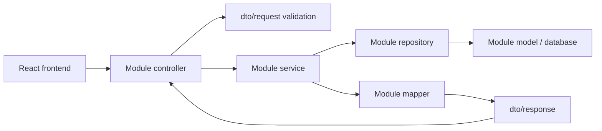

# Cấu trúc backend theo module nghiệp vụ

Backend là một ứng dụng Spring Boot, một Maven project và một database. Code chia theo nghiệp vụ; mỗi module có các tầng MVC và persistence của chính nó.

```text
src/main/java/
  com/example/toeic_api/
    ToeicApiApplication.java
    modules/
      auth/          đăng nhập, JWT, thu hồi phiên, khôi phục mật khẩu
      users/         hồ sơ, tài khoản, quyền, bootstrap admin
      content/       Part, ngữ liệu, ngân hàng câu hỏi và lựa chọn
      practice/      mục luyện tập, tiến độ, bookmark, sự kiện trả lời
      tests/         bộ đề, Part đề, lượt thi, snapshot, deadline
      vocabulary/    chủ đề, bộ từ, từ vựng, collection và tiến độ ôn
      ai/            lời giải AI, chuẩn bị ngữ liệu, tích hợp Groq
      media/         upload và tích hợp Cloudinary
      admin/         tổng quan và thống kê quản trị
    shared/
      api/           ApiResponse dùng chung
      config/        Clock UTC
      exception/     AppException, ErrorCode, GlobalExceptionHandler
      model/         CatalogEntity với version/archive/timestamp
      security/      SecurityConfig, JWT decoder, authentication entry point
  db/migration/      Flyway V1, V2; giữ package và lịch sử migration

src/main/resources/
  application.yml
  db/core-schema.sql   schema ban đầu của V1, được nâng cấp bởi V2

src/test/java/com/example/toeic_api/
  LearningModelIntegrationTest.java
  DatabaseMigrationTest.java
  ToeicApiApplicationTests.java
  modules/
    ai/service/GroqExplanationServiceTest.java
    users/config/ApplicationInitConfigTest.java
```

## Cấu trúc bên trong một module

Ví dụ `modules/vocabulary`:

```text
vocabulary/
  controller/       VocabularyController, AdminVocabularyController
  service/          VocabularyService, VocabularyAdminService
  model/            VocabularyWord, VocabularySet, UserVocabularyProgress, ...
  repository/       VocabularyWordRepository, VocabularySetRepository, ...
  dto/
    request/        VocabularyWordCreateRequest, VocabularySetRequest, ...
    response/       VocabularyWordResponse, VocabularySetResponse, ...
  mapper/           VocabularyMapper
```

Chỉ tạo tầng khi module có nhu cầu: `ai`, `admin`, `media` không có entity/repository riêng vì hiện không sở hữu bảng độc lập. Config theo nghiệp vụ ở chính module, như `users/config/ApplicationInitConfig`, `tests/config/MaintenanceTasks`, `media/config/CloudinaryConfig`.

| Tầng | Trách nhiệm |
| --- | --- |
| `controller` | Nhận HTTP, kiểm tra quyền/validation, gọi service và trả response |
| `service` | Xử lý nghiệp vụ, điều phối, ranh giới transaction |
| `model` | JPA entity, value object và enum của module |
| `repository` | Truy vấn/lưu dữ liệu, gồm truy vấn thống kê của module |
| `dto/request` | Dữ liệu client gửi và các ràng buộc validation |
| `dto/response` | Dữ liệu trả cho client, tách khỏi entity |
| `mapper` | Chuyển giữa model và DTO, gồm các projection lời giải an toàn |
| `config` | Cấu hình/khởi tạo/tác vụ nền đặc thù của module |

Backend dùng REST, không render HTML nên dữ liệu hiển thị nằm ở `dto/response`; React trong `toeic_web` đảm nhiệm giao diện. `QuestionView`, `PracticeViews`, `TestViews`, `HistoryPage` nằm ở `dto/response` của module sở hữu.



## Quy tắc khi thêm tính năng

1. Chọn module theo nghiệp vụ, rồi đặt class vào tầng phù hợp. Không tạo lại các thư mục `controller`, `service`, `entity`, `repository`, `dto` dùng chung ở root package.
2. DTO thuộc module nhận/trả dữ liệu đó. Kiểu dùng chung thực sự như envelope API mới đưa vào `shared`.
3. Controller không truy vấn repository trực tiếp; nghiệp vụ mới đặt trong service. Tích hợp mạng như Groq không giữ transaction database trong thời gian chờ mạng.
4. Các module hiện vẫn có quan hệ JPA và gọi lẫn nhau trong cùng ứng dụng. Đây là tổ chức package; chưa phải ranh giới bị cưỡng chế bằng JPMS hoặc Spring Modulith. Ưu tiên đi qua service khi bổ sung tương tác nghiệp vụ mới.
5. Quản trị theo nghiệp vụ nằm cùng module: quản trị user ở `users`, đề ở `tests`, từ ở `vocabulary`. Module `admin` chỉ phụ trách tổng quan xuyên nghiệp vụ.
6. Tên package không làm thay đổi URL API, JSON, tên bảng hay tên entity JPA. `ToeicApiApplication` giữ ở package gốc để Spring quét tất cả module và shared.
7. Giữ nguyên migration đã chạy. Thay đổi schema tiếp theo cần migration mới trong `db/migration`; không sửa V1/core-schema.sql để phản ánh một thay đổi đã có V2.

## Kiểm chứng sau tái cấu trúc

Chạy `./mvnw.cmd clean test` từ `toeic_api` để loại bỏ class cũ trong `target` và kiểm tra component scan, JPA, repository, mapper và hợp đồng HTTP. Bộ test có kiểm tra `/v3/api-docs` chứa endpoint của cả chín module. Refactor package không yêu cầu migration database mới.

Kết quả ngày 23/10/2026: **35 test đạt**. Đã khởi động trên MySQL local, validate schema và xác minh đăng nhập admin thành công; Flyway V1/V2 không thay đổi.

Chi tiết nghiệp vụ và vận hành: [BACKEND_ARCHITECTURE.md](../BACKEND_ARCHITECTURE.md). Danh sách bảng/field: [DATABASE_SCHEMA.md](../DATABASE_SCHEMA.md).
